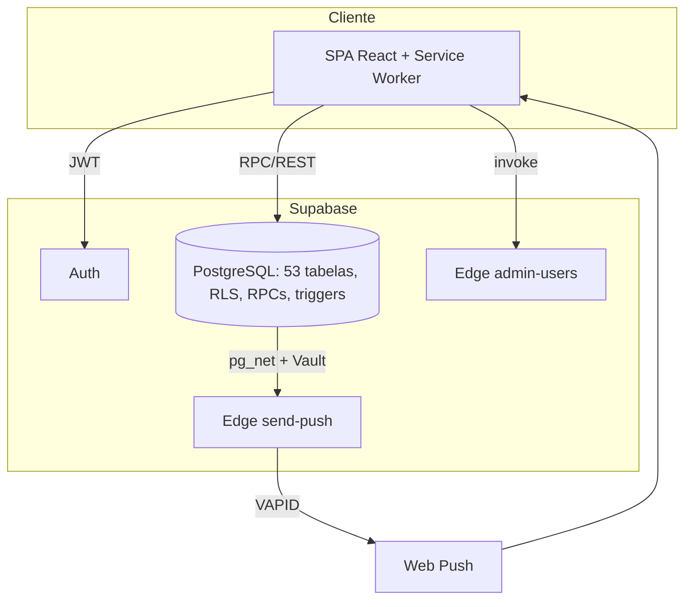

# Arquitetura — DS Lodge

> Arquiteto Reversa · doc_level=completo · pt-br. 🟢 confirmado · 🟡 inferido · 🔴 lacuna.
> Documentos irmãos: [c4-context](c4-context.md), [c4-containers](c4-containers.md), [c4-components](c4-components.md), [erd-complete](erd-complete.md), [integrations](integrations.md), [deployment](deployment.md), [spec-impact-matrix](spec-impact-matrix.md), [cross-cutting](cross-cutting.md), análises por módulo em `modules/`.

## 1. Visão geral
DS Lodge é uma SPA/PWA (React 18, Vite 5, TypeScript, React Router 6) sobre Supabase (PostgreSQL 16 + Auth + Edge Functions), hospedada na Vercel. O desenho é **centrado no banco** 🟢: tabelas com RLS, regras de negócio em ~RPCs `SECURITY DEFINER`, auditoria por triggers e notificações por triggers. O front é fino: telas, mapa de erros, i18n e espelhos de regras para feedback imediato. Escala: 400 arquivos; 178 TS/TSX, 38 migrações SQL, 2 Edge Functions, 86 arquivos de teste.

## 2. Estilo arquitetural 🟢
| Decisão | Evidência |
|---|---|
| Backend = banco (RPC-centric); sem API própria | `surface.json`: `rpc_centric_backend`; ~116 chamadas `.rpc/.from` |
| Autorização no banco (RLS + `can_*`) e espelhada no front | `house_scope` (M29), `AuthProvider.canWriteLodge` |
| Privilégios mínimos por padrão | `alter default privileges … revoke all on functions` |
| Auditoria genérica imutável | `audit_row`, `audit_immutable` |
| Concorrência otimista | coluna `version` + `bump_version` → `stale_version` |
| Tempo do servidor como verdade | `server_now()`, dia operacional 07h Dublin |
| Sem Realtime; atualização por consulta/relógio | nenhum canal no código |
| Push assíncrono desacoplado | trigger → pg_net → Edge → Web Push; nunca bloqueia a gravação |
| Offline parcial | `sw.js` + folha de continuidade; sem fila de escrita 🟡 |

## 3. Módulos (11) e fronteiras
| Módulo | Tabelas principais | Telas/arquivos |
|---|---|---|
| acesso-e-autenticacao | staff, mfa_email_challenges, duty_posts | AuthProvider, Login, EmailCode, ChangePassword, admin-users |
| moradores-e-presenca | residents, stays, room_check_*, sightings, absences, no_shows, access_log | Seen, BedMap, Residents, ResidentProfile, Absences, NoShows, DailySheet |
| ocorrencias-e-passagem-de-turno | handover_*, maintenance_*, warnings, task_* | Handover, Maintenance, Warnings, Tasks |
| servicos-da-casa | fridges/readings, food_deliveries, suppliers, dinner_*, laundry_* | Fridge, Deliveries, Dinner, Laundry |
| compras-e-fornecedores | shop_items/orders/lines (+ legado products/purchases) | Purchases |
| equipe-escala-e-horas | rota_shifts, work_intervals, vacations, holiday_locks | Rota, Hours, Vacations, Users |
| painel-relatorios-e-auditoria | audit_log (leitura), views/RPCs `report_*` | Today, Reports, Audit, HomeDashboard |
| configuracoes-e-cadastros | lodges, rooms, beds, parameters, handover_tags | Settings, Structure |
| continuidade-offline | — | Continuity, `sw.js` |
| notificacoes-e-push | notifications, reads, push_* | Notifications, `push.ts`, send-push |
| interface-e-i18n | — | i18n, theme, Dialog, Toast |

## 4. Fluxos arquiteturais-chave
1. **Login de gestão**: senha → `staff` ativo → `must_change_password`? → `mfa_satisfied()`? → código por e-mail → `ready`.
2. **Ronda de presença**: `room_check_runs` (lodge+dia+slot) → marcas por `stay` → pendências → `no_shows` ao fim do dia.
3. **Passagem de turno**: `open_handover_shift` → entradas/tags/coautores → fechamento → confirmação de horas (`shift_hours_review`) → `work_intervals`.
4. **Alerta push**: RPC insere `notifications` → `notify_push` → `send-push` → SW.
5. **Compra e entrega**: `shop_orders` (draft → placed → delivered) ↔ `food_deliveries` via `link_delivery_to_order`.

## 5. Dívidas técnicas 🟡
| # | Dívida | Evidência |
|---|---|---|
| D1 | Modelo legado de compras (products/purchases/movements) sem uso na UI | questions.md [compras] |
| D2 | Regras duplicadas SQL × TS (`can_write_lodge`, dia operacional, funções da Rota) com divergências conhecidas | spec-impact-matrix §5 |
| D3 | i18n: só `en-IE` na UI, mas banco e Edge tratam 3 idiomas; usuário editado volta a en-IE | cross-cutting §5 |
| D4 | `admin-users`: CORS `*`, sem rate limit/log | integrations §3 |
| D5 | VAPID subject genérico (`mailto:noreply@example.com`) | send-push |
| D6 | Sem CI/CD, sem rollback de migração, sem monitoramento | deployment §5 |
| D7 | Âncoras de semana divergentes (Rota 00h × Hours 07h) | questions.md [equipe] |
| D8 | `mark_password_changed` não é transacional com `updateUser` | módulo acesso |
| D9 | Tipos TS escritos à mão (`types.ts`) sem geração a partir do esquema | 🟡 |
| D10 | Sem CSP; dependência de `localStorage` para locale | vercel.json |
| D11 | Texto histórico (`food_deliveries.supplier`) duplica `supplier_id` | ERD §4 |

## 6. Riscos e pontos de atenção
- Novo tipo de alerta precisa de 3 edições coordenadas (`push_keys`, `message()`, regex de `push_prefs.key`).
- Migrações sem `down` e aplicadas manualmente via Management API.
- Alto acoplamento ao horário de Dublin: qualquer outro fuso exigiria mudar SQL e TS.
- Tabelas de estrutura são editáveis (`update_lodge`, `set_room_active`) com guardas (`structure_guard`); efeitos retroativos em estadias abertas (ver questions.md).

## 7. Confiança
Banco, front, Edge e SW: 🟢. SMTP, domínio/ambientes Vercel, rotina de migração em produção e deploy das funções: 🟡/🔴 (fora do repositório).
