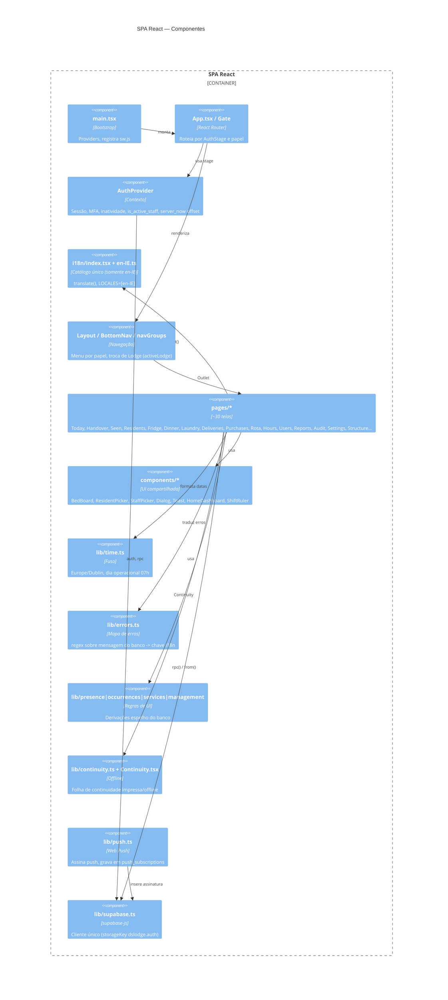
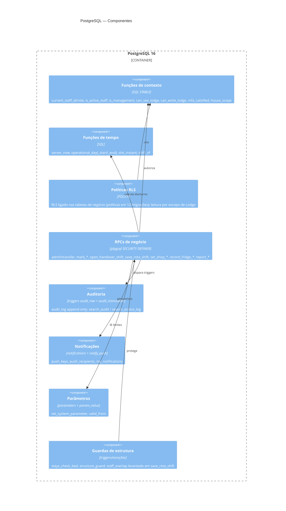
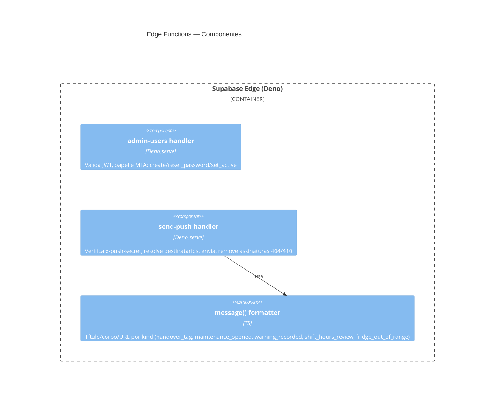

# C4 Nível 3 — Componentes

> Containers detalhados: SPA React, PostgreSQL (camada RPC) e Edge Functions. 🟢 confirmado · 🟡 inferido

## 1. SPA React

Responsabilidades por módulo funcional (ver `_reversa_sdd/modules/`): acesso-e-autenticacao (AuthProvider, Login, EmailCode, ChangePassword), moradores-e-presenca (Seen, BedMap, Residents, ResidentProfile, Absences, NoShows, DailySheet, PrintSheet), ocorrencias-e-passagem-de-turno (Handover, Maintenance, Warnings, Tasks), servicos-da-casa (Fridge, Deliveries, Dinner, Laundry), compras-e-fornecedores (Purchases), equipe-escala-e-horas (Rota, Hours, Vacations, Users), painel-relatorios-e-auditoria (Today, Reports, Audit, HomeDashboard), configuracoes-e-cadastros (Settings, Structure), continuidade-offline (Continuity, sw.js), notificacoes-e-push (Notifications, push.ts), interface-e-i18n (i18n, theme, Dialog, Toast).

## 2. Camada de banco (PostgreSQL)

## 3. Edge Functions

