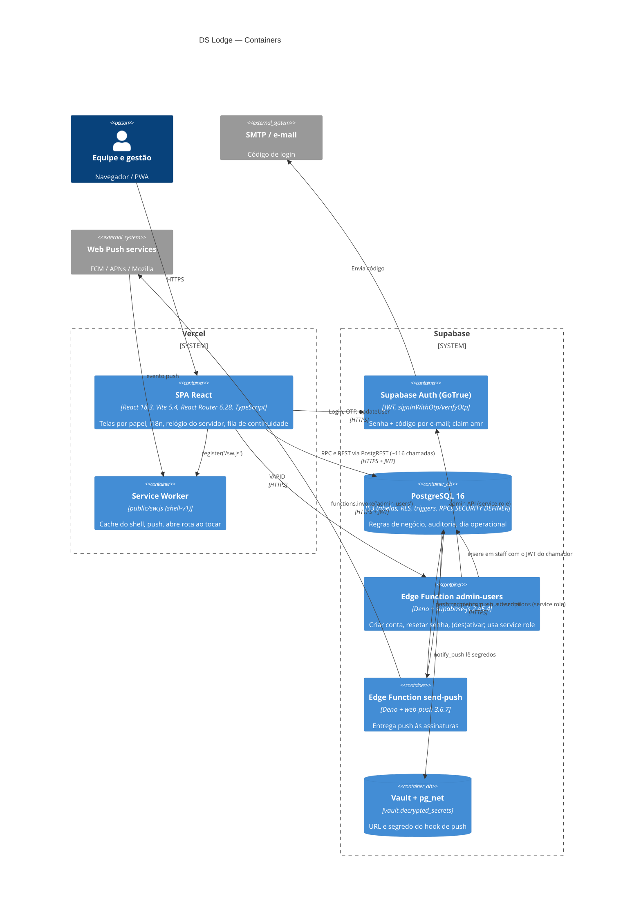

# C4 Nível 2 — Containers

> 🟢 confirmado · 🟡 inferido · 🔴 lacuna

| Container | Tecnologia | Responsabilidade | Confiança |
|---|---|---|---|
| SPA | React/Vite/TS, `@/` alias, Vitest | UI, estados de acesso (`AuthStage`), mapeamento de erros, i18n | 🟢 |
| Service Worker | JS puro | Cache `shell-v1` (rede primeiro para navegação; cache primeiro para assets); push | 🟢 |
| PostgreSQL | PL/pgSQL | Todas as regras (RPCs), RLS, auditoria, notificações | 🟢 |
| admin-users | Deno | Única operação com chave de serviço acionada pelo front | 🟢 |
| send-push | Deno | Disparada apenas pelo banco, protegida por `x-push-secret` | 🟢 |
| Realtime | — | **Não usado**: não há canais Realtime no front; atualização por consultas/relógios (🟡 polling de 60 s em `AuthProvider`) | 🟡 |

Dívida 🟡: ambas as Edge Functions usam `mailto:noreply@example.com` como assunto VAPID e `admin-users` tem CORS `*` (ver questions.md).
