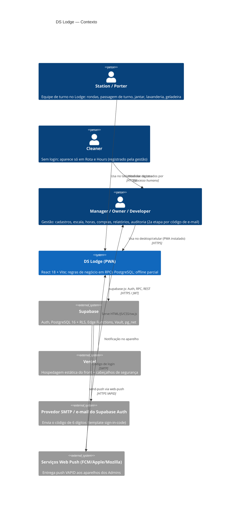

# C4 Nível 1 — Contexto do sistema DS Lodge

> Arquiteto Reversa · 🟢 confirmado · 🟡 inferido · 🔴 lacuna

DS Lodge é um PWA operacional de abrigos ("Lodges") da DePaul/DS em Dublin: presença de moradores, passagem de turno, manutenção, serviços da casa, compras, escala e horas, com trilha de auditoria.

## Atores 🟢
| Ator | Papel no banco (`staff_role`) | Observação |
|---|---|---|
| Station | `station` | Vê só o Lodge de casa (`home_lodge_id`) |
| Porter | `porter` | Escopo de operação por posto (`duty_posts`) |
| Cleaner | `cleaner` | `user_id` nulo (CHECK em `staff`) |
| Manager/Owner | `manager`,`owner` | Gestão; exige `mfa_satisfied()` |
| Developer | `developer` | Mesmo conjunto de privilégios de gestão (`is_management`) |

## Sistemas externos 🟢/🟡
- Supabase (Auth, DB, Edge Functions, Vault): 🟢.
- Vercel: 🟢 (`vercel.json`); sem CI/CD no repositório (`ci_cd: []`) 🟢.
- SMTP: 🟡 — o SQL/front usam `signInWithOtp`; o provedor SMTP é configuração do projeto Supabase fora do repositório (apenas o template `supabase/templates/sign-in-code.html` está versionado).
- Web Push: 🟢 (`web-push@3.6.7`, VAPID).
