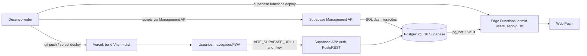

# Deployment — Vercel + Supabase

> Arquiteto Reversa · 🟢 confirmado · 🟡 inferido · 🔴 lacuna. Sem Dockerfile, docker-compose ou CI/CD no repositório (`surface.json`: `ci_cd: []`, `docker: {}`).

## 1. Front (Vercel) 🟢
- Build: `vite build` (npm); saída estática SPA. `vercel.json` faz rewrite de qualquer rota (exceto `/assets/`) para `/index.html` e define cabeçalhos de segurança.
- Variáveis de build (expostas ao navegador, nunca segredos):

| Variável | Uso | Obrigatória |
|---|---|---|
| `VITE_SUPABASE_URL` | URL do projeto Supabase | sim (`supabaseConfigured`) |
| `VITE_SUPABASE_ANON_KEY` | chave pública anon | sim |
| `VITE_VAPID_PUBLIC_KEY` | chave pública VAPID para assinar push | não (push desligado sem ela) 🟡 |

- Sem a URL/anon key o Login exibe aviso (`Login.tsx`) e o cliente cai para `http://localhost:54321` 🟢.
- Ambientes (preview/produção) e domínio: 🔴 não definidos no repositório.

## 2. Banco (Supabase) 🟢
- 38 migrações em `supabase/migrations/` (`20261120000001` … `20261126000038`), ordem lexicográfica, sem `down`.
- **Aplicação**: não há `supabase db push` documentado; `scripts/demo.mjs` e utilitários executam SQL pela **Management API** (`POST https://api.supabase.com/v1/projects/{ref}/database/query`) usando token de acesso em variável de ambiente (`SUPABASE_ACCESS_TOKEN`) 🟢. Migrações de produção seguem o mesmo caminho 🟡 (inferido do padrão dos scripts).
- Seeds: `supabase/seed/demo.sql`, `demo-enrich.sql` (dados de demonstração; `residents.is_demo`), `20261120000002_seed_structure.sql` (estrutura real: Lodges/quartos/camas) 🟢.
- Ambiente local/teste: `supabase/local/auth_shim.sql` simula `auth` num Postgres comum; `tests/db/*.test.ts` (Vitest) rodam contra ele; `pg_net`/`vault` ausentes → `notify_push` vira no-op 🟢.
- Pós-aplicação manual: criar segredos `push_hook_url` e `push_hook_secret` no Vault 🟢 (não versionados).
- `scripts/bootstrap-account.mjs`: criação da primeira conta de gestão 🟡; `scripts/db-reset.mjs`: reset de ambiente de demonstração 🟡.

## 3. Edge Functions 🟢
| Função | Segredos/variáveis (nomes) | Verificação |
|---|---|---|
| admin-users | `SUPABASE_URL`, `SUPABASE_ANON_KEY`, `SUPABASE_SERVICE_ROLE_KEY` | JWT do chamador + papel + MFA |
| send-push | `PUSH_HOOK_SECRET`, `VAPID_PUBLIC_KEY`, `VAPID_PRIVATE_KEY`, `SUPABASE_URL`, `SUPABASE_SERVICE_ROLE_KEY` | cabeçalho `x-push-secret` |
Implantação por CLI do Supabase 🟡 (sem script versionado).

## 4. Auth/SMTP 🔴
Provedor SMTP, template ativo e limites de envio vivem no painel Supabase; só o HTML do template está no repositório.

## 5. Lacunas operacionais
- Sem pipeline de CI (testes `vitest`, `tests/e2e/*.cjs` Playwright rodam manualmente) 🟢.
- Sem estratégia de rollback de migração, backup/restore documentado, nem monitoramento 🔴.
- Ordem recomendada de release (🟡): aplicar migrações → deploy das Edge Functions → deploy do front (o front novo assume RPCs novas).
