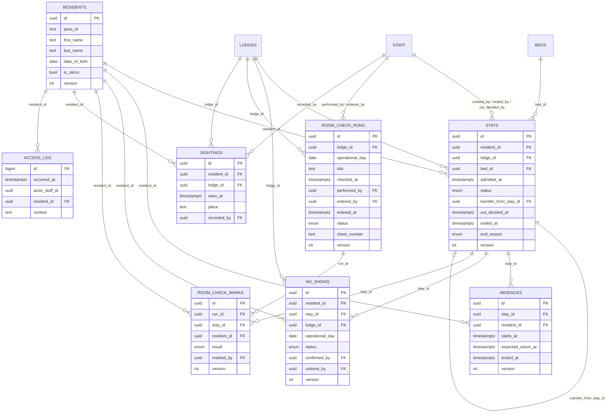
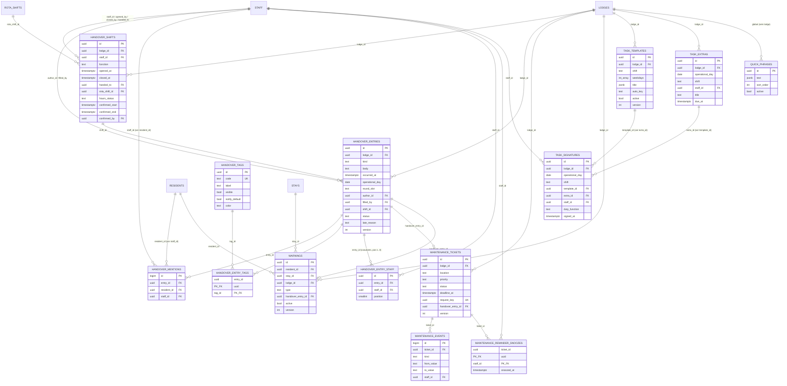
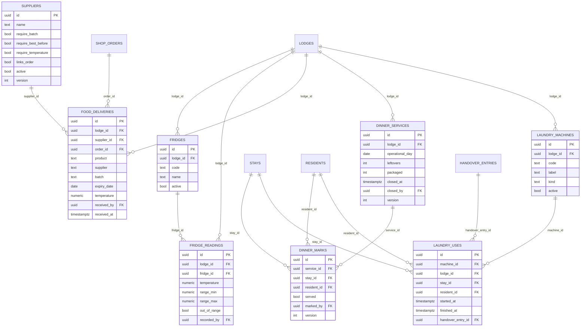

# ERD completo — DS Lodge

> Arquiteto Reversa · doc_level=completo · fonte: `supabase/migrations/*.sql` (38 migrações, 53 tabelas em `public`, mais `auth.users` do Supabase).
> Escala: 🟢 confirmado no SQL · 🟡 inferido · 🔴 lacuna. Atributos limitados aos principais (PK, FK, campos de negócio, `version` de concorrência otimista).
> Mudanças por `ALTER TABLE` posteriores estão incorporadas (ex.: `fridge_readings.fridge_id`, `food_deliveries.supplier_id/order_id`, `handover_entries.shift_id/filled_by`, `rota_shifts.planned_*`, `handover_tags.color`, `shop_orders.delivered_*`).

## 1. Estrutura física e pessoas

```mermaid
erDiagram
    AUTH_USERS ||--o| STAFF : "user_id (1:0..1)"
    LODGES ||--o{ ROOMS : "lodge_id"
    ROOMS ||--o{ BEDS : "room_id"
    LODGES ||--o{ STAFF : "home_lodge_id"
    STAFF ||--o{ DUTY_POSTS : "staff_id"
    LODGES ||--o{ DUTY_POSTS : "lodge_id (office)"
    LODGES ||--o{ PARAMETERS : "lodge_id (nulo = global)"
    AUTH_USERS ||--o{ MFA_EMAIL_CHALLENGES : "user_id"

    AUTH_USERS {
        uuid id PK
        text email
    }
    LODGES {
        uuid id PK
        text code UK
        text name
        text short_name
        bool has_dinner
        bool has_laundry
        bool active
    }
    ROOMS {
        uuid id PK
        uuid lodge_id FK
        enum kind
        text code
        int sort_order
        bool active
    }
    BEDS {
        uuid id PK
        uuid room_id FK
        int number
        enum status
        bool active
        int version
    }
    STAFF {
        uuid id PK
        uuid user_id FK_UK
        text full_name
        text display_name
        enum role
        enum locale
        uuid home_lodge_id FK
        bool active
        bool must_change_password
        int version
    }
    DUTY_POSTS {
        uuid id PK
        uuid staff_id FK
        enum function
        uuid lodge_id FK
        timestamptz started_at
        timestamptz ended_at
        text end_reason
    }
    PARAMETERS {
        bigint id PK
        text key
        uuid lodge_id FK
        jsonb value
        timestamptz valid_from
    }
    MFA_EMAIL_CHALLENGES {
        bigint id PK
        uuid user_id FK
        timestamptz created_at
    }
```

Notas 🟢: `staff.role` inclui station/porter/cleaner/manager/owner/developer (`check (role <> 'cleaner' or user_id is null)` — Cleaner não tem login). `parameters` é um histórico versionado por `valid_from` (a leitura usa `param_value(key)`), sem FK para `staff` em `created_by`. `mfa_email_challenges` não é exposta a `anon/authenticated` (RLS ligado, privilégios revogados).

## 2. Moradores, estadias e presença



Notas 🟢: `unique (lodge_id, operational_day, slot)` em `room_check_runs`; `unique (run_id, stay_id)` em `room_check_marks`; `performed_by` ≠ `entered_by` é rastreado (coluna gerada `performed_reported_by_entrant`). `no_shows` guarda `undo_reason`. `access_log` registra leituras de perfil (RPC `open_resident_profile`), sem UPDATE.

## 3. Ocorrências, passagem de turno, manutenção e avisos



Nota 🟡: `quick_phrases` não tem FK; é catálogo global trilíngue (`text jsonb`). Os ids de menções (`handover_mentions`) usam XOR (`resident_id` ou `staff_id`) via CHECK 🟢.

## 4. Serviços da casa (geladeira, entregas, jantar, lavanderia)



Nota 🟢: `food_deliveries.supplier` (texto) coexiste com `supplier_id` (FK) — texto histórico copiado no registro (ver questions.md). Faixa da geladeira é copiada em cada leitura (`range_min/max`), por isso a leitura é autocontida.

## 5. Compras, equipe, escala e horas

```mermaid
erDiagram
    SHOP_ITEMS ||--o{ SHOP_ORDER_LINES : "item_id"
    SHOP_ORDERS ||--o{ SHOP_ORDER_LINES : "order_id (cascade)"
    STAFF ||--o{ SHOP_ORDERS : "created_by / delivered_by"
    PRODUCTS ||--o{ PURCHASE_LINES : "product_id (legado)"
    PURCHASES ||--o{ PURCHASE_LINES : "purchase_id (legado)"
    PRODUCTS ||--o{ PRODUCT_MOVEMENTS : "product_id (legado)"
    PURCHASE_LINES ||--o{ PRODUCT_MOVEMENTS : "purchase_line_id (legado)"
    LODGES ||--o{ PRODUCT_MOVEMENTS : "from_lodge_id / to_lodge_id (legado)"
    STAFF ||--o{ ROTA_SHIFTS : "staff_id"
    LODGES ||--o{ ROTA_SHIFTS : "lodge_id (nulo se float)"
    STAFF ||--o{ WORK_INTERVALS : "staff_id"
    LODGES ||--o{ WORK_INTERVALS : "lodge_id"
    STAFF ||--o{ VACATIONS : "staff_id"
    STAFF ||--o{ HOLIDAY_LOCKS : "created_by"
    STAFF ||--o{ PUSH_SUBSCRIPTIONS : "staff_id"
    STAFF ||--o{ PUSH_PREFS : "staff_id"
    NOTIFICATIONS ||--o{ NOTIFICATION_READS : "notification_id"
    STAFF ||--o{ NOTIFICATION_READS : "staff_id"
    LODGES ||--o{ NOTIFICATIONS : "lodge_id"
    RESIDENTS ||--o{ NOTIFICATIONS : "resident_id"

    SHOP_ITEMS {
        uuid id PK
        text category
        text name
        int default_qty
        text default_action
        text tesco_url
        bool active
        int version
    }
    SHOP_ORDERS {
        uuid id PK
        date delivery_date
        text status
        timestamptz placed_at
        timestamptz delivered_at
        uuid created_by FK
    }
    SHOP_ORDER_LINES {
        uuid id PK
        uuid order_id FK
        uuid item_id FK
        int standard_qty
        text action
        int delta
        int final_qty "gerada"
        numeric unit_price
    }
    PRODUCTS {
        uuid id PK
        text name
        text unit
        bool active
    }
    PURCHASES {
        uuid id PK
        text supplier
        date purchased_on
        text document_ref
        uuid created_by FK
    }
    PURCHASE_LINES {
        uuid id PK
        uuid purchase_id FK
        uuid product_id FK
        numeric quantity
        numeric unit_price
        numeric line_total "gerada"
    }
    PRODUCT_MOVEMENTS {
        uuid id PK
        text kind
        uuid product_id FK
        uuid purchase_line_id FK
        uuid from_lodge_id FK
        uuid to_lodge_id FK
        numeric quantity
    }
    ROTA_SHIFTS {
        uuid id PK
        uuid staff_id FK
        uuid lodge_id FK
        text function
        timestamptz starts_at
        timestamptz ends_at
        timestamptz planned_starts_at
        timestamptz planned_ends_at
        text status
        int version
    }
    WORK_INTERVALS {
        uuid id PK
        uuid staff_id FK
        uuid lodge_id FK
        timestamptz starts_at
        timestamptz ends_at
        int version
    }
    VACATIONS {
        uuid id PK
        uuid staff_id FK
        date starts_on
        date ends_on
        text status
    }
    HOLIDAY_LOCKS {
        uuid id PK
        date starts_on
        date ends_on
        bool active
    }
    NOTIFICATIONS {
        bigint id PK
        text kind
        text audience
        uuid lodge_id FK
        uuid resident_id FK
        jsonb payload
    }
    NOTIFICATION_READS {
        bigint notification_id PK_FK
        uuid staff_id PK_FK
        timestamptz read_at
    }
    PUSH_SUBSCRIPTIONS {
        uuid id PK
        uuid staff_id FK
        text endpoint UK
        text p256dh
        text auth
        timestamptz last_used_at
    }
    PUSH_PREFS {
        uuid staff_id PK_FK
        text key PK
        bool enabled
    }
    AUDIT_LOG {
        bigint id PK
        timestamptz occurred_at
        uuid actor_user_id
        uuid actor_staff_id
        text action
        text table_name
        text record_id
        jsonb old_data
        jsonb new_data
    }
```

Notas 🟢: o modelo `products/purchases/purchase_lines/product_movements` é **legado** (sem chamadas em `src/`; ver questions.md); o fluxo vivo é `shop_items → shop_orders → shop_order_lines`. `audit_log` não tem FKs (propositalmente genérico: `table_name` + `record_id` texto) e é imutável (trigger `audit_immutable`).

## 6. Inventário das 53 tabelas por domínio

| Domínio | Tabelas |
|---|---|
| Estrutura/identidade (8) | lodges, rooms, beds, staff, duty_posts, parameters, mfa_email_challenges, audit_log |
| Moradores/presença (9) | residents, stays, access_log, room_check_runs, room_check_marks, sightings, absences, no_shows, warnings |
| Ocorrências/tarefas (14) | handover_shifts, handover_entries, handover_mentions, handover_tags, handover_entry_tags, handover_entry_staff, quick_phrases, maintenance_tickets, maintenance_events, maintenance_reminder_snoozes, task_templates, task_extras, task_signatures, notifications |
| Serviços (8) | fridges, fridge_readings, food_deliveries, dinner_services, dinner_marks, laundry_machines, laundry_uses, suppliers |
| Compras (7) | shop_items, shop_orders, shop_order_lines, products*, purchases*, purchase_lines*, product_movements* (*legado) |
| Equipe/escala (4) | rota_shifts, work_intervals, vacations, holiday_locks |
| Notificações/push (3) | notification_reads, push_subscriptions, push_prefs |

(`notifications` aparece em Ocorrências por ser gerada pelas RPCs dessas telas; contagem total de tabelas únicas = 53 🟢.)
