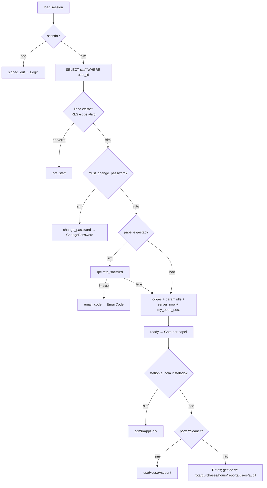
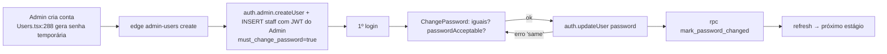
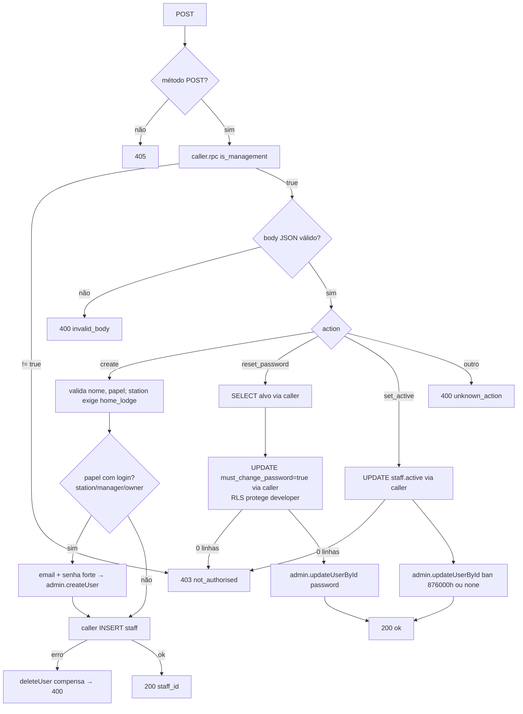
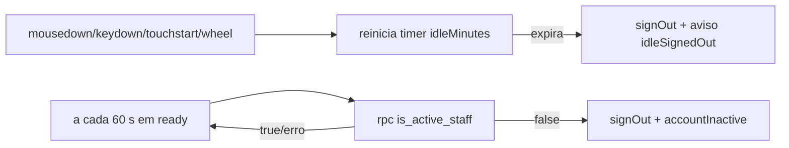
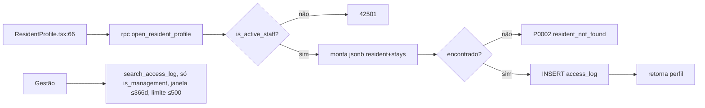

# acesso-e-autenticacao — Fluxogramas

Fontes: `src/auth/AuthProvider.tsx`, `src/pages/{Login,EmailCode,ChangePassword}.tsx`, `supabase/functions/admin-users/index.ts`, `20261120000005_email_code_second_step.sql`, `20261125000029_house_scope.sql`. Confiança 🟢 salvo indicação.

## 1. Estágios de acesso (`AuthProvider.load`, `:67-123`)



## 2. Segunda etapa por e-mail (sequência)

```mermaid
sequenceDiagram
  participant U as Usuário gestão
  participant FE as EmailCode.tsx
  participant DB as Postgres (RPC)
  participant AU as Supabase Auth
  U->>AU: signInWithPassword (amr=password)
  FE->>DB: begin_email_verification()
  DB-->>DB: exige amr password; <5 pedidos/15min; INSERT mfa_email_challenges
  FE->>AU: signInWithOtp(email, shouldCreateUser=false)
  AU-->>U: e-mail com código
  U->>FE: digita código (>=6)
  FE->>AU: verifyOtp(type=email)
  AU-->>FE: nova sessão (amr inclui otp)
  FE->>DB: (AuthProvider) mfa_satisfied()
  DB-->>DB: desafio.created_at em [otp-15min, otp+1min]?
  DB-->>FE: true → ready
```

## 3. Primeira senha



## 4. Edge function admin-users



## 5. Posto (assume_post)

```mermaid
flowchart TD
  A[assume_post fn, lodge, confirm] --> B{can_see_lodge e staff ativo?}
  B -- não --> X[42501 not_authorised]
  B -- sim --> C{fn=office → role=porter?<br/>fn=float → porter|manager?}
  C -- não --> X2[role_cannot_take_*]
  C -- sim --> D[advisory lock duty_posts]
  D --> E{ocupante outro no posto?}
  E -- sim, sem confirm --> OC[retorna occupied]
  E -- sim, confirm --> TK[encerra ocupante: taken_over]
  E -- não --> F
  TK --> F{eu já tenho posto?}
  F -- igual --> AL[already_on_post]
  F -- diferente --> SW[encerra: switched] --> INS
  F -- nenhum --> INS[INSERT duty_posts] --> OK[assumed]
```

## 6. Inatividade e desativação (cliente)



## 7. Leitura sensível auditada


