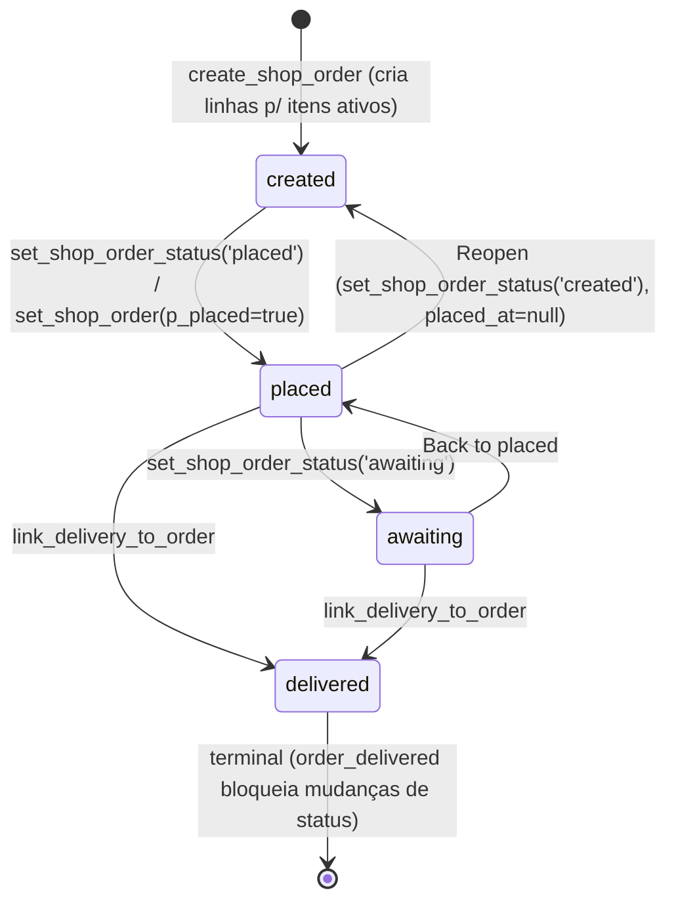
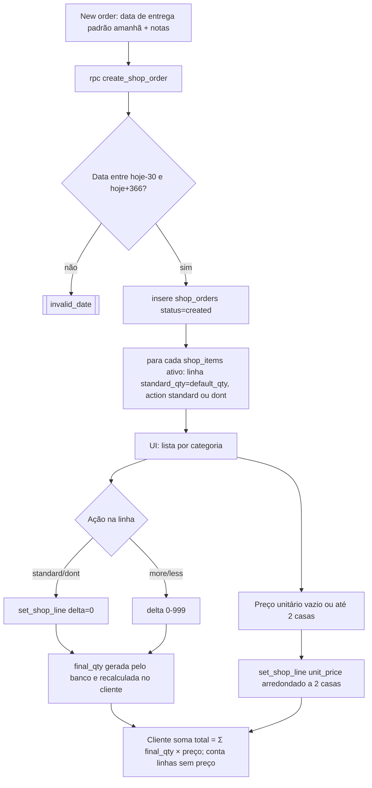
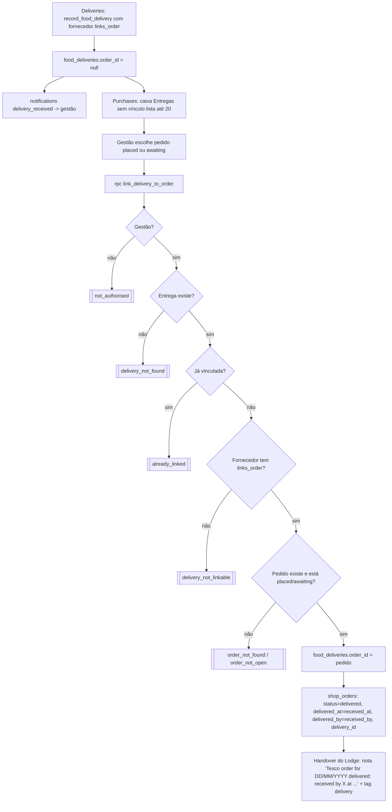
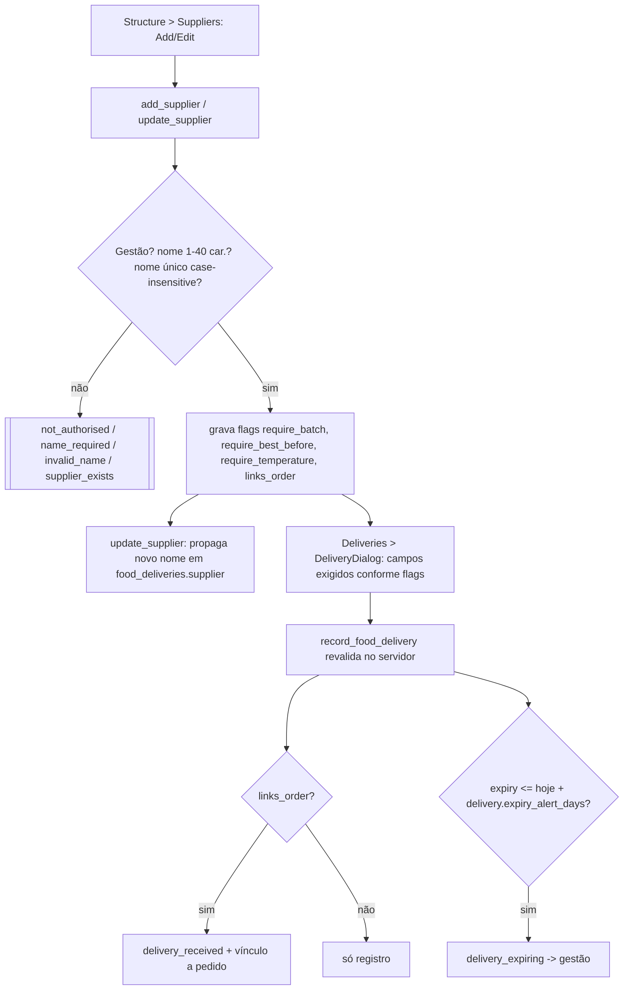
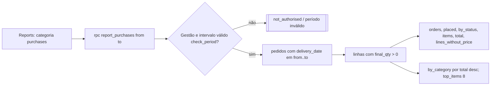

# compras-e-fornecedores — Fluxogramas

Legenda: 🟢 confirmado (referências arquivo:linha em `code-analysis.md`).

## 1. Ciclo de vida do pedido (máquina de estados) 🟢

## 2. Montar o pedido (Purchases.tsx) 🟢

## 3. Receber entrega e vincular ao pedido 🟢

## 4. Cadastro de fornecedor e efeito nos campos obrigatórios 🟢

## 5. Relatório de compras 🟢

