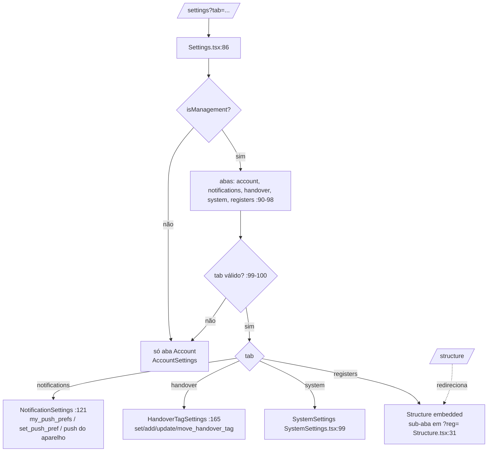
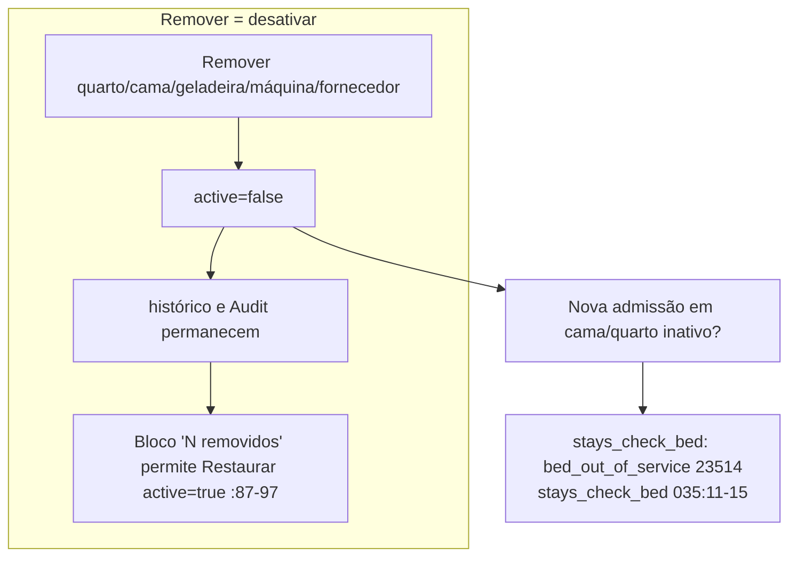
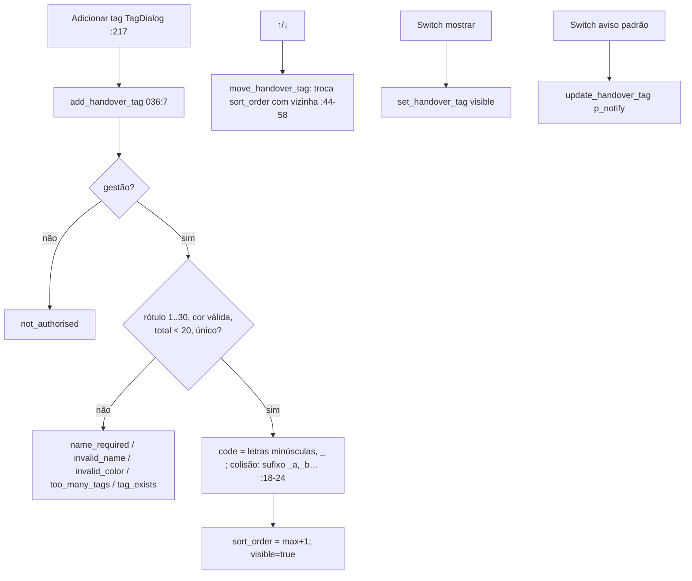
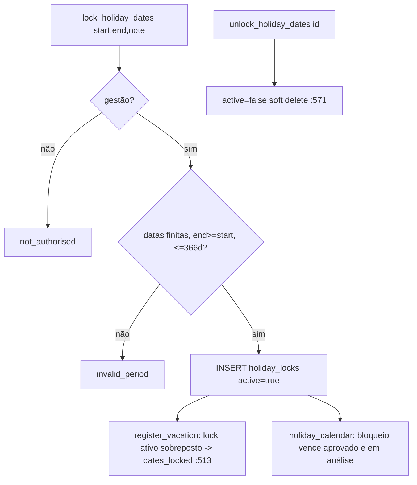

# Fluxogramas — configuracoes-e-cadastros

> Âncoras de código entre colchetes. Diagramas Mermaid.

## 1. Navegação de Configurações

## 2. Salvar um parâmetro do sistema

```mermaid
flowchart TD
  U[Usuário edita seção e clica Salvar] --> S1[Section.save SystemSettings.tsx:33]
  S1 --> S2[onSave: setParam key,value em sequência :55]
  S2 --> RPC[rpc set_system_parameter]
  RPC --> A{current_staff_id e is_management?<br/>system_settings.sql:15}
  A -- não --> E1[not_authorised 42501]
  A -- sim --> B{chave conhecida?}
  B -- não --> E2[unknown_parameter 22023<br/>ex.: security.require_mfa_management]
  B -- sim --> C{tipo/limites válidos?<br/>more_settings.sql:21-58}
  C -- não --> E3[invalid_parameter 22023]
  C -- sim --> D[normaliza: ordena/deduplica horários, int, objeto]
  D --> I[INSERT parameters key,value,valid_from=now,created_by :63]
  I --> T[trigger audit_parameters -> audit_log]
  I --> OK[toast Saved + load&#40;&#41; recarrega<br/>currentParams: mais recente com valid_from <= agora :15]
  E1 & E2 & E3 --> ER[Notice com errorKey]
  S2 -. 2ª chamada falha .-> P[1ª já gravada: sem transação 🟡]
```

## 3. Cadastro de estrutura (quartos, camas, geladeiras, máquinas, casas)

```mermaid
flowchart TD
  U[Ação na UI Structure.tsx] --> R[useAction.run name,args :76]
  R --> RPC[rpc add_room / rename_room / add_bed / set_*_active / add_fridge / add_laundry_machine / update_lodge]
  RPC --> G[structure_guard: gestão? 034:4-8]
  G -- não --> X1[not_authorised]
  G -- sim --> V{validações}
  V -->|nome vazio| X2[name_required]
  V -->|nome longo| X3[invalid_name]
  V -->|tipo inválido| X4[invalid_kind]
  V -->|camas fora de 1..12| X5[too_many_beds]
  V -->|duplicado case-insens.| X6[room_exists 23505]
  V -->|desativar com stay não encerrado| X7[room_occupied / bed_occupied 23514]
  V -->|máquina com uso aberto| X8[machine_busy 23514]
  V -->|id inexistente| X9[*_not_found P0002]
  V -->|ok| W[INSERT/UPDATE e trigger audit_row]
  W --> OK[toast Saved + reload&#40;&#41;]
  X1 & X2 & X3 & X4 & X5 & X6 & X7 & X8 & X9 --> ER[Notice com errorKey]
```

## 4. Tags do Handover

## 5. Isolamento por casa (leitura)

```mermaid
flowchart TD
  Q[SELECT em tabela com lodge_id] --> P[políticas permissivas: is_active_staff]
  Q --> R[política RESTRICTIVE house_scope<br/>house_scope.sql:40]
  R --> L{lodge_id is null?}
  L -- sim --> OK[visível]
  L -- não --> CS[can_see_lodge&#40;lodge&#41; :12]
  CS --> U{auth.uid nulo?<br/>contexto interno}
  U -- sim --> OK
  U -- não --> V{is_active_staff?}
  V -- não --> NO[invisível]
  V -- sim --> W{papel = station?}
  W -- não --> OK
  W -- sim --> Z{lodge = house_scope&#40;&#41; = home_lodge_id?}
  Z -- sim --> OK
  Z -- não --> NO
  P --> AND[resultado = permissiva AND restritiva]
```

```mermaid
flowchart TD
  WR[can_write_lodge&#40;lodge&#41; :19] --> A{is_management?}
  A -- sim --> OK[escrita permitida]
  A -- não --> B{station na própria casa ativa?}
  B -- sim --> OK
  B -- não --> C{posto aberto: float ou da casa?}
  C -- sim --> OK
  C -- não --> NO[recusa]
```

## 6. Bloqueio de datas (holiday_locks)

