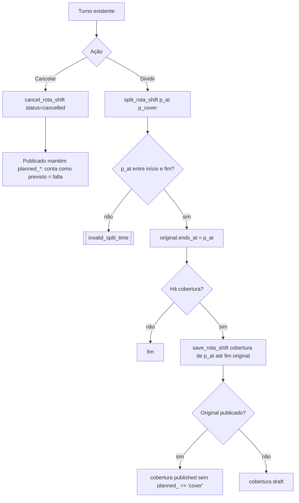
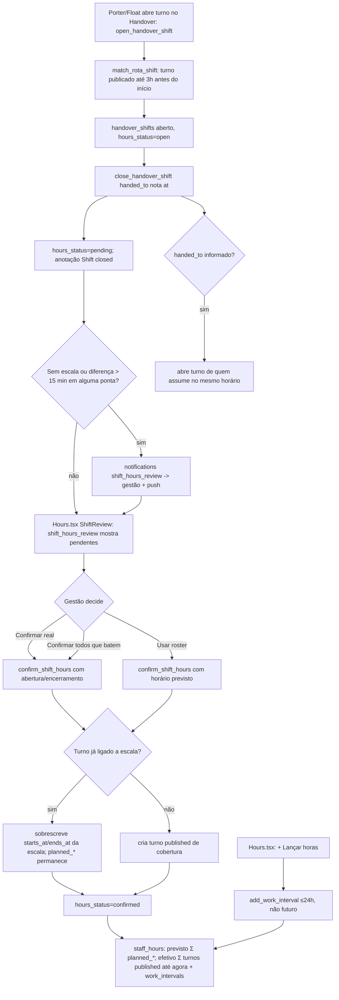
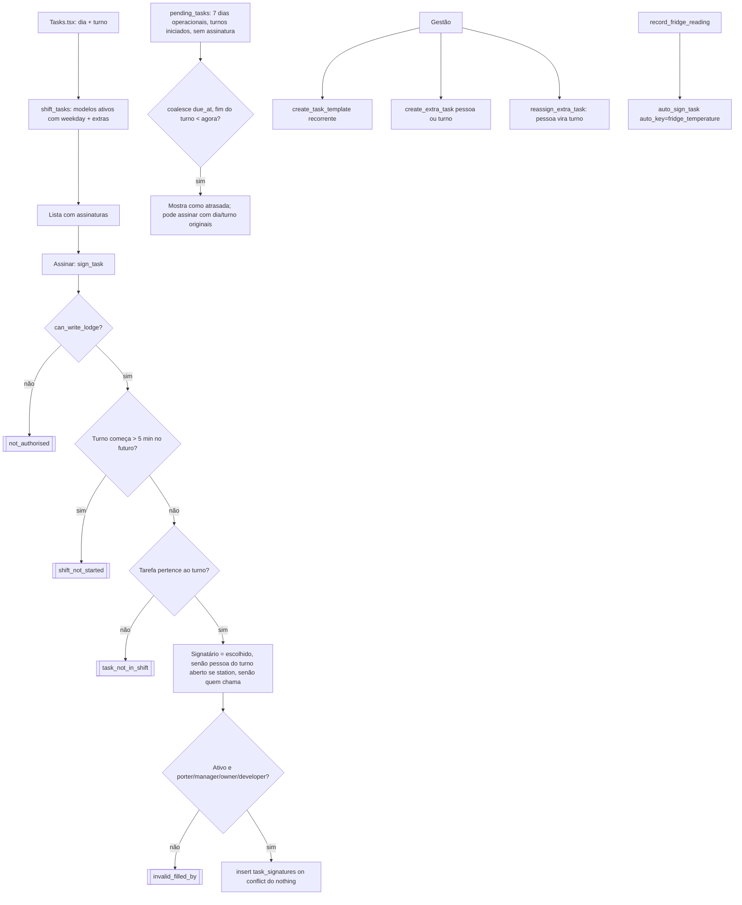
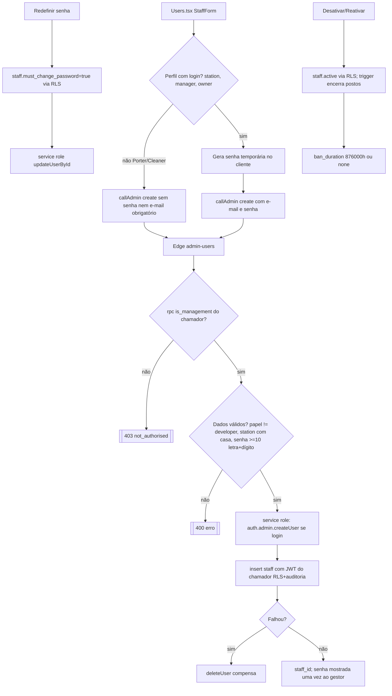

# equipe-escala-e-horas — Fluxogramas

Legenda: 🟢 confirmado (referências em `code-analysis.md`).

## 1. Rota: montar, publicar e cobertura 🟢
```mermaid
flowchart TD
  A[Rota.tsx: gestão abre ShiftDialog] --> B[Escolhe função, pessoa elegível rotaRoles, Lodge, dia, início, fim]
  B --> C[fim <= início => dia seguinte; Float sem Lodge]
  C --> D[rpc save_rota_shift]
  D --> E{Gestão, período válido, pessoa ativa?}
  E -- não --> X1[[not_authorised / invalid_period / staff_not_found]]
  E -- sim --> F{Perfil permitido na função? office=porter, float=porter|manager, cleaner<->cleaner}
  F -- não --> X2[[role_not_allowed]]
  F -- sim --> G{Mesma pessoa com turno sobreposto?}
  G -- sim --> X3[[staff_overlap]]
  G -- não --> H{Float e já há outro Float no intervalo?}
  H -- sim --> X4[[float_overlap]]
  H -- não --> I[insert ou update do rascunho/turno]
  I --> J[status draft: só gestão vê]
  J --> K[rpc publish_rota from..to, máx 62 dias]
  K --> L[drafts do intervalo -> published, planned_* = starts/ends]
  L --> M[coverage_gaps: janelas Day 07-19, Night 19-07, Float 12-24]
  M --> N{Janela sem nenhum turno que a intersecte?}
  N -- sim --> O[notifications coverage_below_minimum + aviso na tela]
  N -- não --> P[ok]
  L --> Q[Equipe passa a ver o publicado; useOnDuty usa a escala]
```

## 2. Dividir e cancelar turno 🟢


## 3. Horas: previsto × efetivo e confirmação do Handover 🟢


## 4. Daily Tasks: assinar e pendências 🟢


## 5. Users: criar, redefinir senha, desativar 🟢

