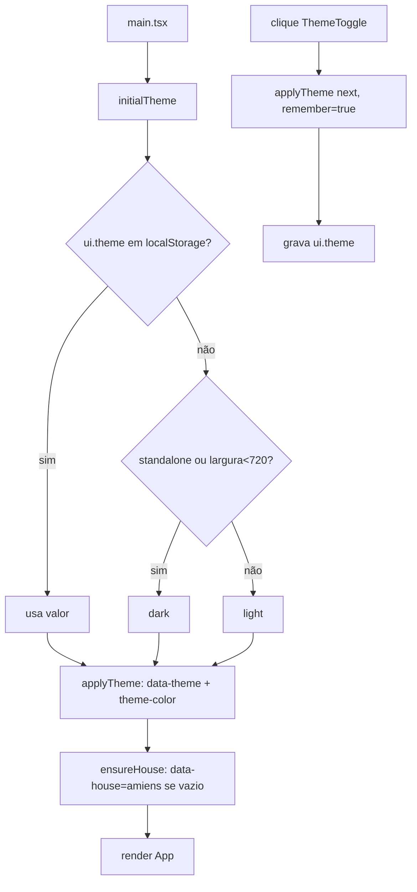
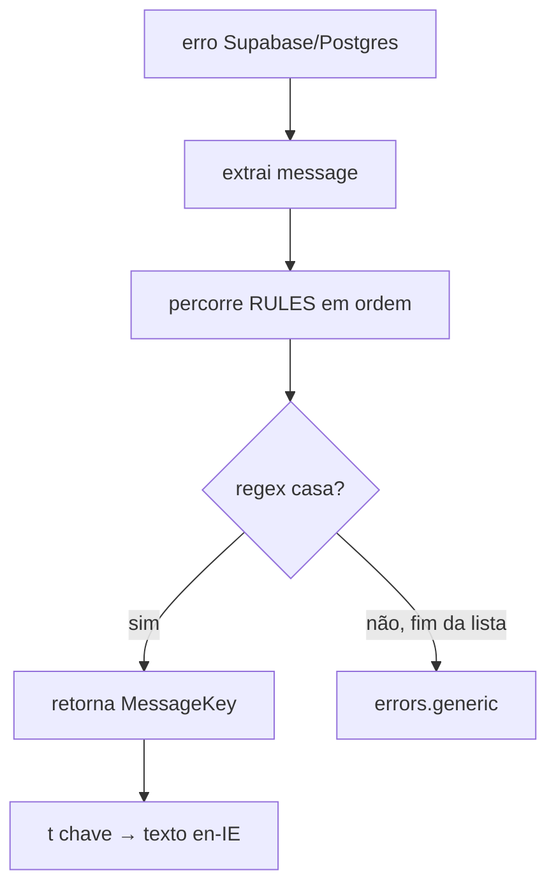
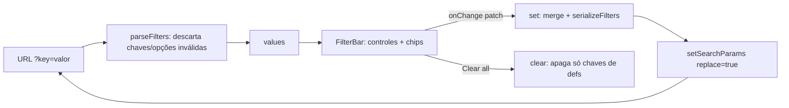
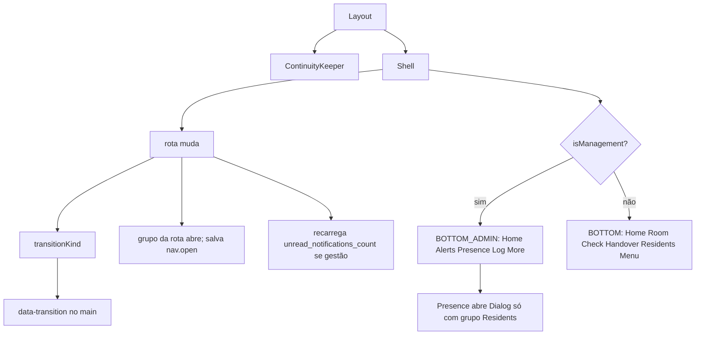
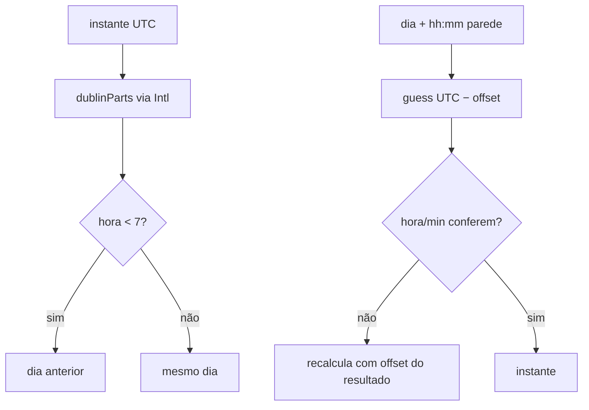

# Fluxogramas — interface-e-i18n

## Tema na inicialização e troca 🟢 (`main.tsx:9-10`, `theme.ts`, `ThemeToggle.tsx:7-12`)

## Erro do banco → mensagem 🟢 (`errors.ts:104-112`)

## Filtros na URL 🟢 (`filters.ts`, `useUrlFilters.ts`)

## Casca e navegação 🟢 (`Layout.tsx`)

## Tempo Dublin 🟢 (`time.ts`)

