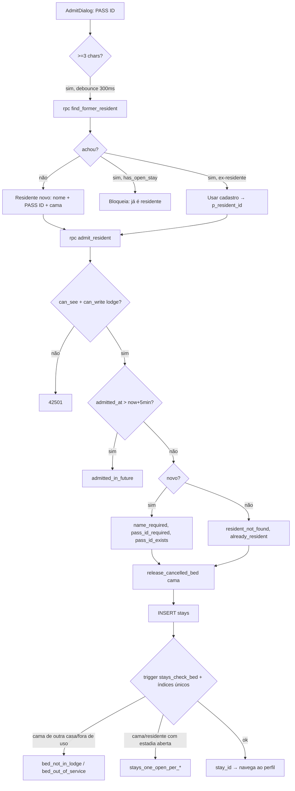
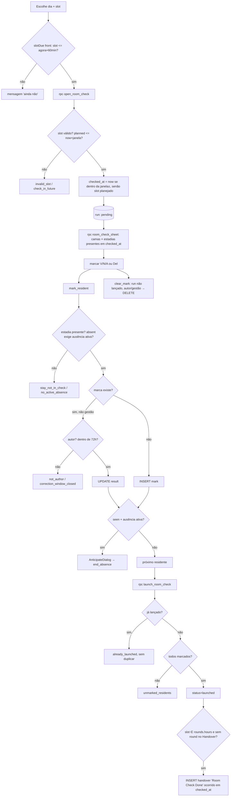
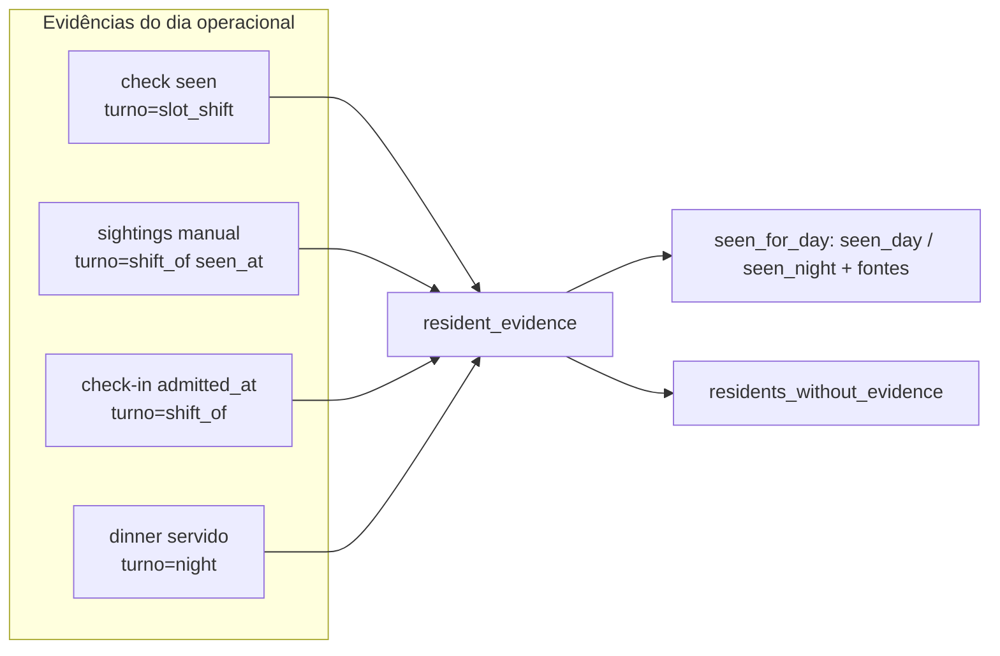
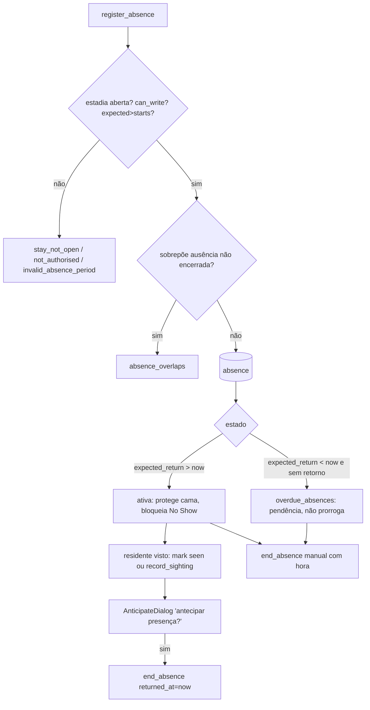

# moradores-e-presenca — Fluxogramas

Fontes: `20261120000001_foundation.sql`, `..._000006_presence.sql`, `20261125000029_house_scope.sql`, `20261125000032_more_settings.sql`, `20261126000037_r15.sql`, `20261126000038_r16.sql`, páginas `src/pages/{Residents,ResidentProfile,BedMap,DailySheet,Seen,Absences,NoShows}.tsx`. 🟢 salvo indicação.

## 1. Ciclo de vida da estadia

```mermaid
stateDiagram-v2
  [*] --> active: admit_resident
  active --> out_pending: decide_out (motivo obrigatório; quem escreve na casa)
  out_pending --> active: withdraw_out (gestão ou quem decidiu)
  active --> ended: effect_out (gestão) end_reason=out
  out_pending --> ended: effect_out (gestão)
  out_pending --> ended: release_cancelled_bed<br/>(outra admissão/transferência ocupa a cama)
  active --> ended: transfer_resident end_reason=transfer
  ended --> [*]
  note right of active: cria nova estadia ligada por transfer_from_stay_id
```



## 2. Admissão



## 3. Room Check (Folha do dia)



## 4. Seen — derivação



## 5. Ausência comunicada



## 6. No Show (lista das 06h30)

```mermaid
flowchart TD
  S[no_show_review lodge, day] --> P{pending_slots vazio?}
  P -- não --> I[complete=false → confirmar bloqueado]
  P -- sim --> F{now >= fim do dia − 30min?}
  F -- não --> NF[day_finished=false]
  F -- sim --> C[candidatos: sem evidência, sem ausência, sem No Show confirmado]
  C --> SEL[Office revisa; todos pré-selecionados]
  SEL --> CF[confirm_no_shows]
  CF --> V{can_write? dia terminado? checks lançados?}
  V -- não --> E[not_authorised / day_not_finished / checks_pending]
  V -- sim --> LOOP[para cada estadia: ainda candidata?]
  LOOP -- não --> ENC[not_a_candidate → rollback total]
  LOOP -- sim --> INS[INSERT no_shows confirmed]
  INS --> CNT[month_count: mês calendário desde início da cadeia de transferências]
  CNT --> LIM{count >= limite (3)?}
  LIM -- sim --> NT[notifications no_show_monthly_limit → gestão]
  LIM -- não --> END[ok]
  NT --> END
  END --> UND[gestão: undo_no_show com motivo → status undone, contador ignora]
```

## 7. Mapa de camas / Out

```mermaid
flowchart TD
  B[BedMap clique em cama] --> Q{tem residente e stay != out_pending?}
  Q -- sim --> PF[perfil do residente]
  Q -- não --> G{gestão?}
  G -- sim --> MG[diálogo: admitir / fora de serviço (nota) / voltar a uso → UPDATE beds com version]
  G -- não --> W{in_use e canWriteLodge?}
  W -- sim --> AD[AdmitDialog com cama fixa]
  PF --> A[Ações no perfil]
  A --> T[Transferir: FreeBedSelect → transfer_resident]
  A --> DO[Decidir Out → decide_out]
  A --> WO[Retirar Out → withdraw_out]
  A --> EO[Efetivar Out (gestão) → effect_out]
```
