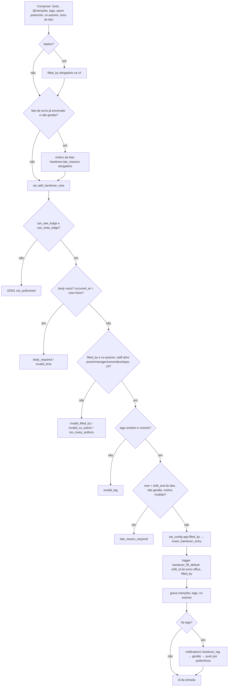
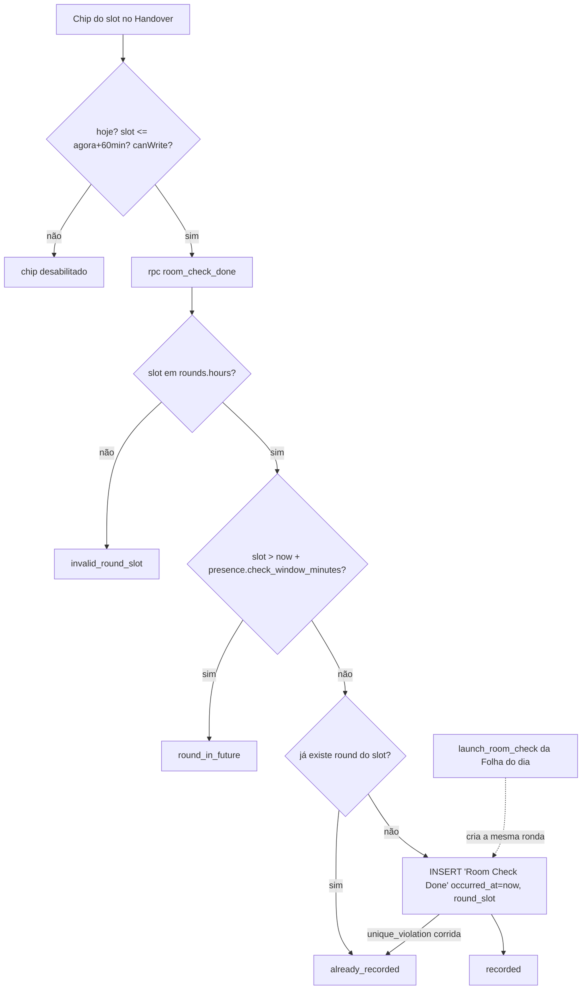
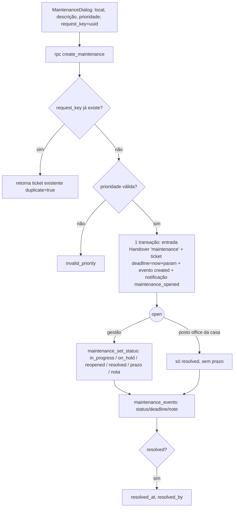
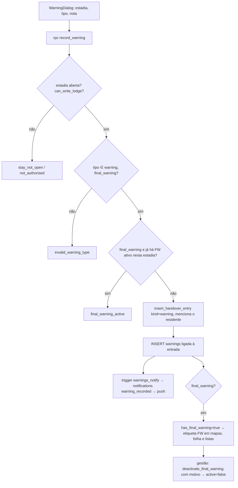
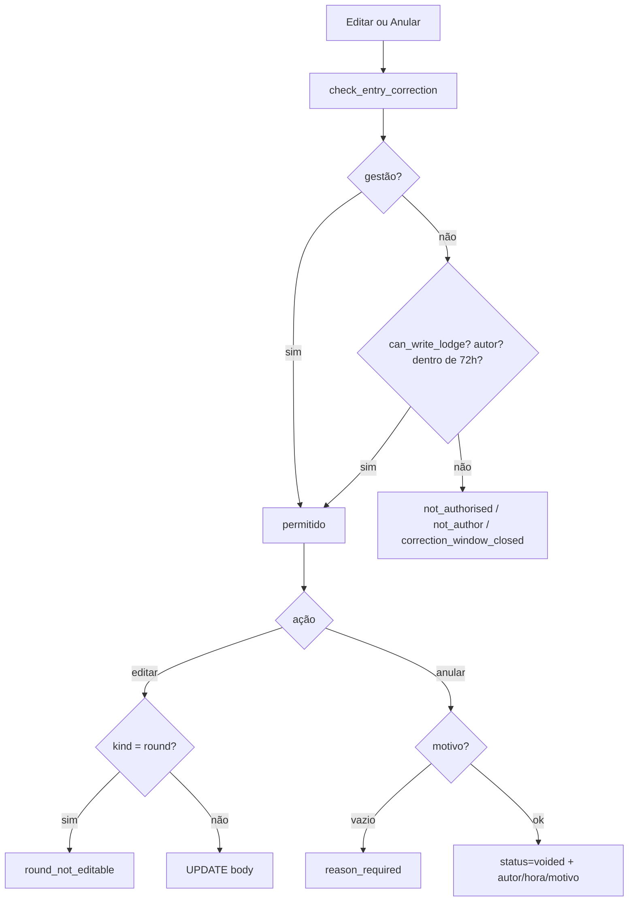

# ocorrencias-e-passagem-de-turno — Fluxogramas

Fontes: `20261120000007_occurrences.sql`, `..._000018_handover_shifts.sql`, `..._000025_float_shift.sql`, `..._000026_shift_times.sql`, `..._000029_house_scope.sql`, `..._000032_more_settings.sql`, `20261126000037_r15.sql`, `src/pages/{Handover,Maintenance,Warnings}.tsx`. 🟢 salvo indicação.

## 1. Registrar nota no Handover



## 2. Ronda "Room Check Done"



## 3. Turnos do Livro Ata

```mermaid
stateDiagram-v2
  [*] --> SemTurno
  SemTurno --> Aberto: open_handover_shift(lodge, quem assume, função, hora)
  Aberto --> Fechado: close_handover_shift(sem passagem)
  Aberto --> Aberto2: close_handover_shift(handed_to) abre o turno seguinte na mesma função e hora
  Fechado --> [*]
  note right of Aberto: office: 1 por casa; float: 1 global<br/>match_rota_shift liga ao Roster<br/>entradas 'shift' abertura/fechamento
  note right of Fechado: hours_status = pending<br/>divergência > 15 min ou sem Roster → notificação shift_hours_review
```

```mermaid
flowchart TD
  O[open_handover_shift] --> O1{pode ver/escrever? função válida? hora ∈ [-24h,+5min]?}
  O1 -- não --> OE[42501 / invalid_function / invalid_time]
  O1 -- sim --> O2{staff é porter/manager/owner/developer ativo?}
  O2 -- não --> OE2[invalid_filled_by]
  O2 -- sim --> O3{já há turno aberto dessa função (float global; office da casa)?}
  O3 -- sim --> OE3[shift_already_open]
  O3 -- não --> OI[INSERT handover_shifts + entrada 'Shift opened — Nome']
```

## 4. Chamado de manutenção



```mermaid
flowchart LR
  A[Gestão: poll 5 min] --> B[rpc maintenance_reminders]
  B --> C{prazo vencido, sem evento desde max(prazo, now-24h), sem snooze 24h?}
  C -- sim --> D[Diálogo: Resolvido / Em andamento+novo prazo / Em espera+nota / Depois]
  D -->|Depois| S[snooze_maintenance_reminder]
  D -->|demais| U[maintenance_set_status]
  D -->|X| X[sessionStorage: ocultar 1 h]
```

## 5. Warning / Final Warning



## 6. Busca no Handover

```mermaid
flowchart TD
  F[Qualquer filtro na FilterBar] --> S{searching?}
  S -- não --> Q1[SELECT handover_entries do dia operacional]
  S -- sim --> Q2[rpc search_handover from=to-29d por padrão]
  Q2 --> V{from/to válidos? intervalo ≤ 92 dias?}
  V -- não --> E[invalid_range / range_too_large]
  V -- sim --> R[filtros: texto ILIKE escapado, tipos, tags, pessoa (filled_by/autor/co-autor), residente (menção), função do turno, anuladas]
  R --> L[limit ≤ 100 ordem occurred_at desc]
  Q1 & L --> J[carrega menções, tags e co-autores das entradas em lote]
```

## 7. Correção / anulação de nota


