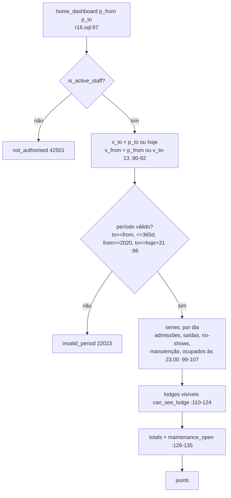
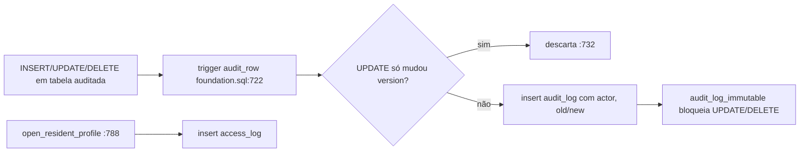

# Fluxogramas — painel-relatorios-e-auditoria

> Âncoras de código entre colchetes. Diagramas Mermaid.

## 1. Home (Today) e painel

```mermaid
flowchart TD
  A[Today monta<br/>Today.tsx:16] --> B{isStation?}
  B -- sim --> C[actionLodge = casa ativa<br/>:27]
  B -- não --> D{posto office?}
  D -- sim --> E[actionLodge = post.lodge_id]
  D -- não --> F[actionLodge = null<br/>Float/gestão veem as duas]
  C & E & F --> G[useNextCheck + useOnDuty + useOccupancy<br/>:20-28]
  G --> H[Botão primário :57-63]
  H --> H1{actionLodge e next.slot?}
  H1 -- sim --> H2[Next check -> /sheet]
  H1 -- não --> H3{gestão sem posto?}
  H3 -- sim --> H4[/no-shows]
  H3 -- não --> H5[Open sheet -> /sheet]
  A --> P[HomeDashboard]
  A --> Q[PendingTile]
  A --> R[BedBoard por casa :123-127]
  P --> P1[período salvo?<br/>HomeDashboard.tsx:113]
  P1 --> P2[preset reancorado em hoje :125]
  P2 --> P3[rpc home_dashboard p_from p_to :127]
  P3 --> P4[poll 120 s :129]
  P3 -->|data| P5[cartões por casa, manutenção, ocupação, movimento]
  P3 -->|erro| P6[ignorado, mantém estado anterior]
  Q --> Q1[usePendingCounts :pending.ts:39]
  Q1 --> Q2[rpc pending_counts por casa :46]
  Q2 --> Q3[sumCounts :8]
  Q3 --> Q4[linhas com contagem > 0 -> links]
  Q1 --> Q5[poll 60 s :50]
```

## 2. `home_dashboard` no servidor



## 3. Reports

```mermaid
flowchart TD
  U[Usuário escolhe período/casa/categoria] --> R[periodRange kind anchor custom<br/>management.ts:116]
  R --> L[load Reports.tsx:83]
  L --> L1[latest&#40;&#41; descarta respostas antigas :85]
  L1 --> L2[report_period agregado]
  L1 --> L3{2+ casas?}
  L3 -- sim --> L4[report_period por casa :89]
  L2 & L4 --> L5[Promise.all :90]
  L5 --> M[reportBlocks por order :60]
  M --> N[blocksOf por categoria :165]
  N --> O[orderedMetrics + formatMetric]
  O --> P{detailMetric existe?}
  P -- sim --> Q[botão abre openDetail :108]
  Q --> Q1[report_details_period metric] --> Q2[Dialog com registros]
  P -- não --> P2[valor simples]
  U --> K{categoria purchases?}
  K -- sim --> K1[report_purchases :105] --> K2[PurchasesReport :19]
```

```mermaid
flowchart TD
  RP[report_period p_lodges p_from p_to<br/>beta_management.sql:119] --> A{is_management?}
  A -- não --> X1[not_authorised]
  A -- sim --> B[check_period :7-17]
  B -- inválido --> X2[invalid_period]
  B -- ok --> C[v_from/v_to = operational_day_start<br/>v_until = least&#40;v_to, now&#40;&#41;&#41; :140-142]
  C --> D[bool_or has_dinner/has_laundry :144]
  D --> E[monta 12 blocos<br/>contagens via report_details_period :147-234]
  E --> F[retorna jsonb com order]
```





## 4. Audit

```mermaid
flowchart TD
  A[Audit monta :50] --> B[aba changes/reads + filtros URL :83]
  B --> C[periodParams :32<br/>De/Até > range; sem nada = servidor 30d]
  C --> D{aba?}
  D -- reads --> E[search_access_log]
  D -- changes --> F[search_audit<br/>p_tables = moduleTables&#40;módulos&#41;]
  E & F --> G{is_management? audit_search.sql:21,58}
  G -- não --> X[not_authorised -> Notice de erro]
  G -- sim --> H{período válido?<br/>finito, to>=from, <=366d}
  H -- não --> X2[invalid_range/range_too_large]
  H -- sim --> I[filtra, ilike escapado, id desc, limit<=500]
  I --> J[UI: setRows, hasMore = len==100 :108]
  J --> K[diffRecord ignora version/id/created_at<br/>audit.ts:6]
  K --> L[linha: 2 mudanças; Detalhes expande; Histórico filtra por record_id]
  J --> M[Load more: p_before = último id :113]
  J --> N[Export CSV só das linhas carregadas :133<br/>toCsv anti-fórmula]
```



## 5. Origem da trilha


