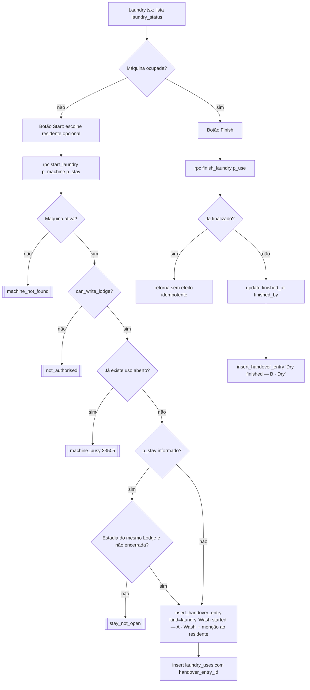
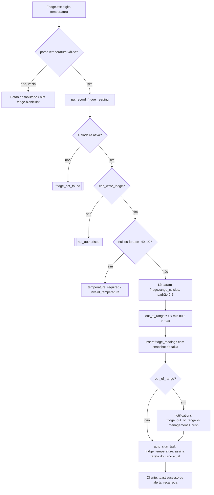
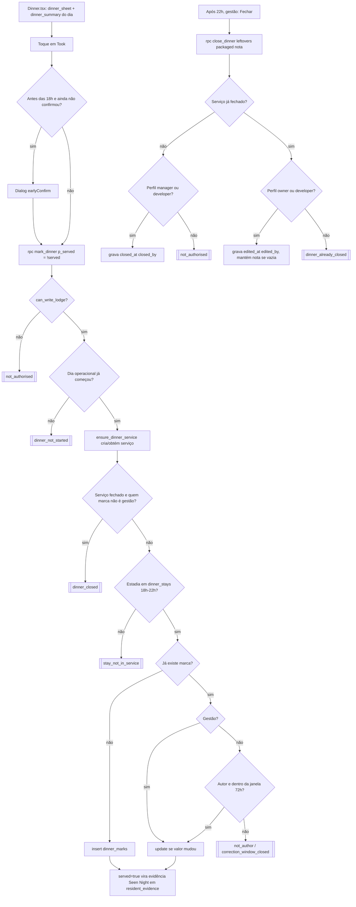
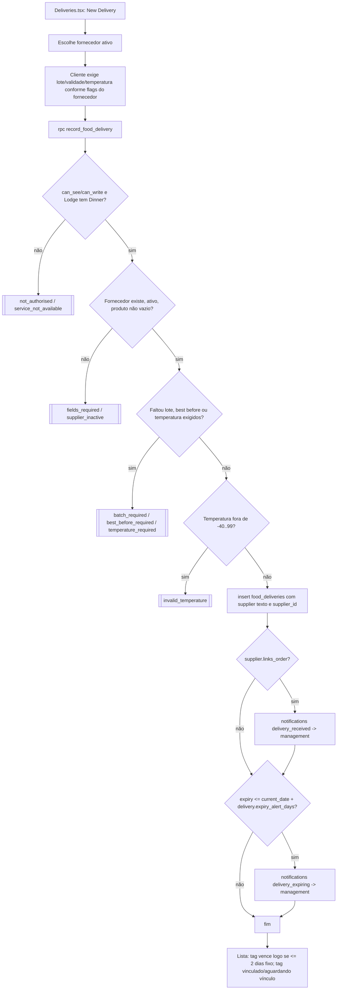

# servicos-da-casa — Fluxogramas

Legenda de confiança: 🟢 confirmado no código (arquivo:linha em `code-analysis.md`).

## 1. Laundry: iniciar e finalizar 🟢

## 2. Fridge: registrar temperatura 🟢

## 3. Dinner: marcar quem pegou e fechar 🟢

## 4. Deliveries: nova entrega e alertas 🟢

