# Máquinas de estado — DS Lodge

> Detetive Reversa · doc_level=completo. 🟢 confirmado no SQL/código · 🟡 inferido · 🔴 lacuna. `Mnn` = migration.
> Nota geral: o banco **valida valores** (CHECK/enum) e pré-condições por função, mas na maioria das entidades **não impõe um grafo** de transições; o grafo abaixo é o permitido pelas RPCs/UI.

## 1. Estadia (`stays.status`: active · out_pending · ended) 🟢
Não existe valor `cancelled`: "cama cancelada" na UI é `out_pending` (decisão de Out aguardando a gestão). `end_reason` ∈ `out | transfer`.
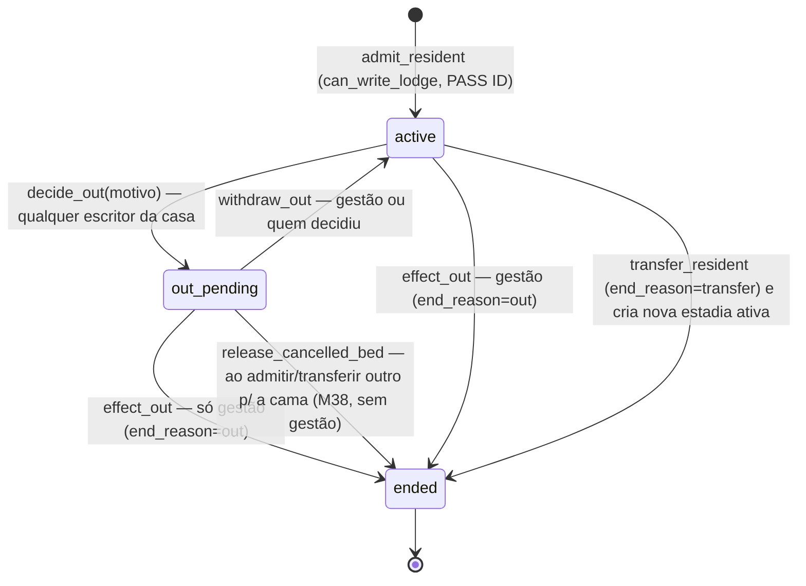
Regras: `transfer_resident` só parte de `active` (`stay_not_active`); `effect_out` falha se `ended` (`stay_not_open`); a cama de uma estadia `out_pending` conta como livre na Home (M38) mas o residente continua listado como `out_pending`.

## 2. Cama (`beds.status`: in_use · out_of_service; `active`) 🟢
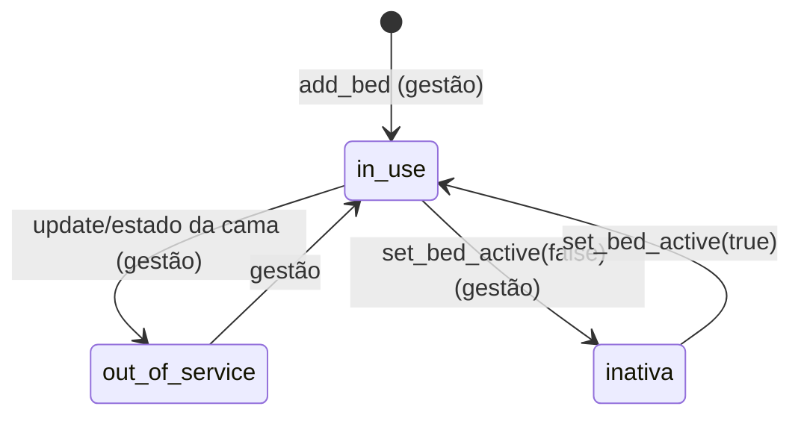
Admissão em `out_of_service` é recusada. `add_bed` não valida quarto ativo (🟡, questions.md).

## 3. No Show (`no_show_status`: confirmed · undone) 🟢
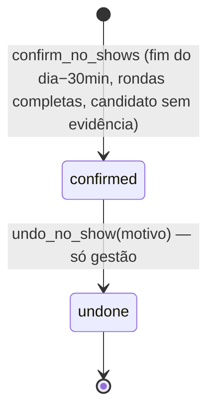
Um `confirmed` por residente/dia (índice parcial); `undone` preserva histórico. `month_count ≥ limite` notifica a gestão.

## 4. Room Check (`room_check_runs.status`: pending · launched) e marcas 🟢
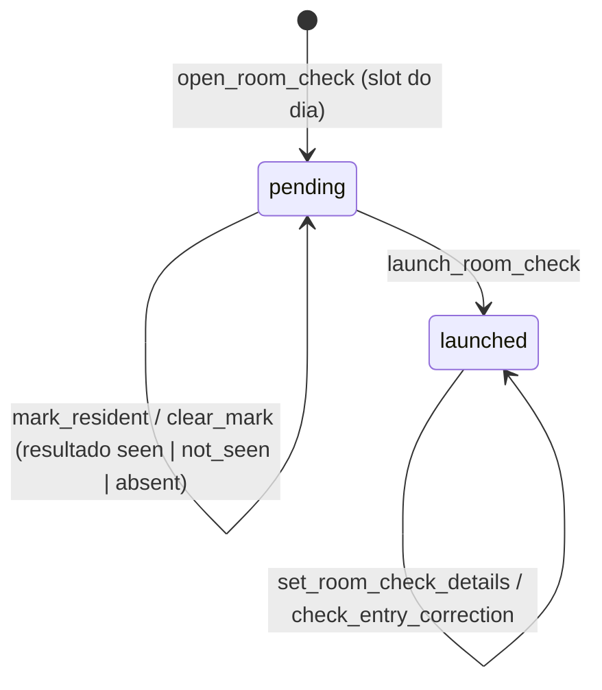
`clear_mark` exige run não lançada e remove a linha de `room_check_marks` (DELETE real, auditado). `mark_resident` pode remarcar enquanto dentro da janela (🟡).

## 5. Ausência (`absences`) 🟢
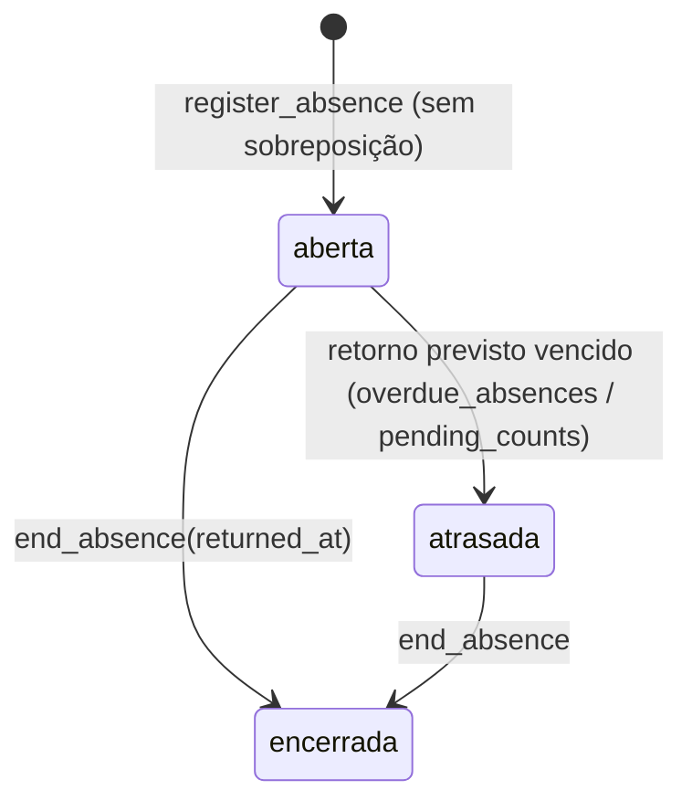
Estado derivado (`ended_at is null` e prazos); não há coluna de status.

## 6. Nota do Handover (`handover_entries.status`: active · voided) 🟢
```mermaid
stateDiagram-v2
    [*] --> active: add_handover_note / insert_handover_entry (kind note|round|maintenance|warning|laundry|shift)
    active --> active: correct_handover_note (só body; gestão ou autor na janela)
    active --> voided: void_handover_note(motivo) (gestão ou autor na janela)
```

## 7. Turno do Handover (`handover_shifts`) 🟢
Ciclo duplo: aberto/fechado (`closed_at`) e `hours_status` ∈ open · pending · confirmed.
```mermaid
stateDiagram-v2
    [*] --> aberto: open_handover_shift (1 por casa; Float global)
    aberto --> fechado_pendente: close_handover_shift (hours_status=pending)
    fechado_pendente --> aberto: passagem — abre turno do próximo (handed_to)
    fechado_pendente --> confirmado: confirm_shift_hours (gestão; ajusta/cria rota_shift)
    confirmado --> [*]
```
Fechar com divergência >15 min do plano da Rota notifica `shift_hours_review`.

## 8. Chamado de manutenção (`maintenance_tickets.status`) 🟢
Valores: open · in_progress · on_hold · resolved · reopened. O banco aceita qualquer troca entre valores válidos (sem grafo); abaixo o fluxo de uso.
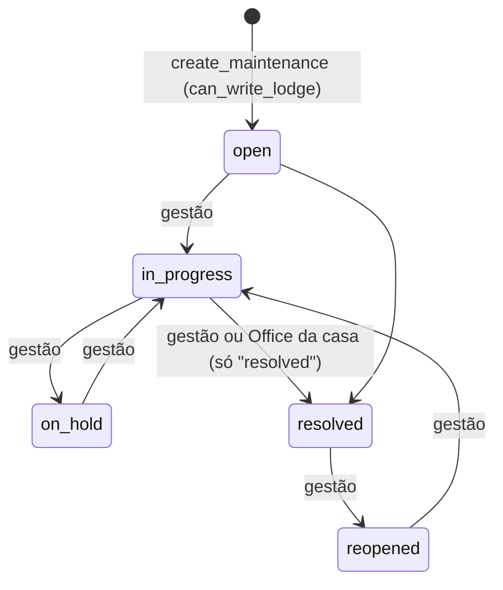
`resolved_at/resolved_by` são preenchidos ao resolver e **não** são limpos ao reabrir. Prazo e prioridade só pela gestão. Lacuna: para `station` (sem posto) a checagem avalia NULL e não bloqueia — ver permissions.md §5.

## 9. Warning / Final Warning (`warnings`) 🟢
`type` ∈ warning · final_warning (desde M37; antes verbal/written/final_written); `active` booleano.
```mermaid
stateDiagram-v2
    [*] --> ativa: record_warning (can_write_lodge) — nota no Handover + notificação
    ativa --> desativada: deactivate_final_warning(motivo) — só gestão, só final_warning
    note right of ativa: Final Warning: no máx. uma ativa por estadia
```
Um `warning` simples não tem desativação (🟡).

## 10. Pedido Tesco (`shop_orders.status`) 🟢
```mermaid
stateDiagram-v2
    [*] --> created: create_shop_order (gestão; data ≥ hoje−30d)
    created --> placed: set_shop_order(p_placed) / set_shop_order_status
    placed --> awaiting: set_shop_order_status
    awaiting --> placed: set_shop_order_status
    placed --> created: set_shop_order_status (zera placed_at)
    placed --> delivered: link_delivery_to_order
    awaiting --> delivered: link_delivery_to_order
    delivered --> [*]: terminal (order_delivered)
```
`draft` do M17 foi migrado para `created` em M37. `set_shop_line` não checa o status (🟡).

## 11. Turno da Rota (`rota_shifts.status`) 🟢
```mermaid
stateDiagram-v2
    [*] --> draft: save_rota_shift (gestão; função×papel; sem sobreposição)
    draft --> published: publish_rota(p_from,p_to)
    published --> cancelled: cancel_rota_shift
    draft --> cancelled: cancel_rota_shift
    published --> published: confirm_shift_hours ajusta horários / split_rota_shift
```

## 12. Férias (`vacations.status`) 🟢
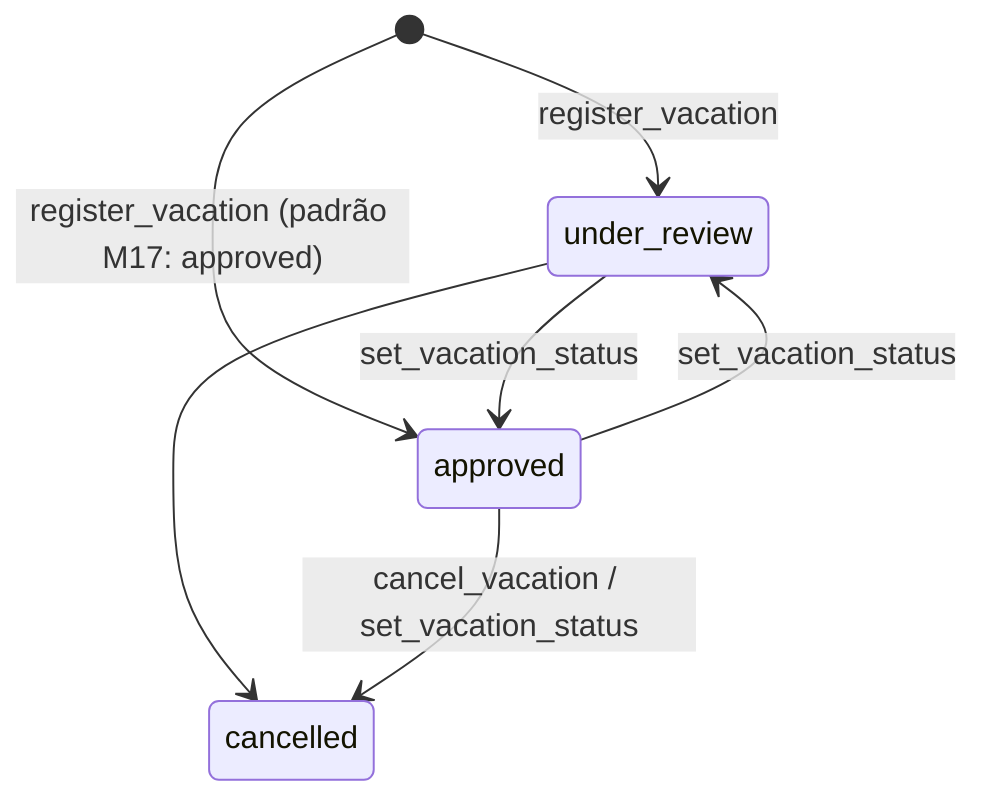
`under_review` e `approved` contam para conflitos de cobertura.

## 13. Entrega de alimentos e vínculo 🟡
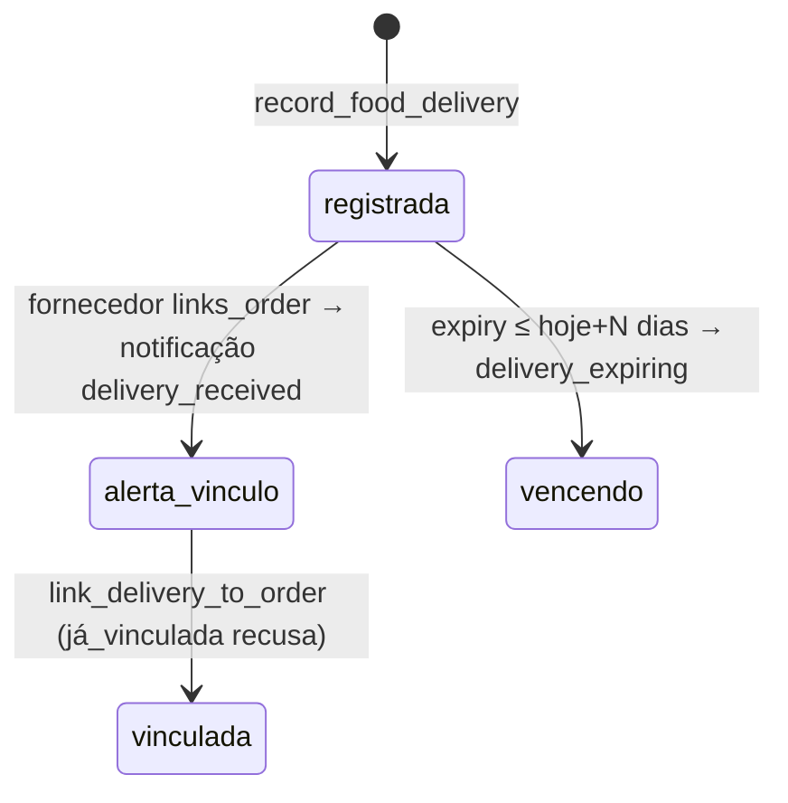
Não há desvinculação nem anulação (sem RPC).

## 14. Acesso/Autenticação (front `AuthStage`) e MFA 🟢
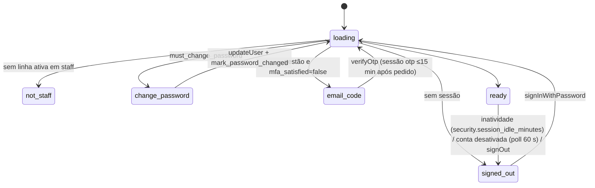
MFA no banco: pedido `begin_email_verification` (sessão com senha; máx. 5 em 15 min) → sessão `otp` → `mfa_satisfied()` verdadeiro se o pedido está em [sessão−15 min, sessão+1 min]. `security.require_mfa_management=false` desliga a exigência.

## 15. Notificações 🟡
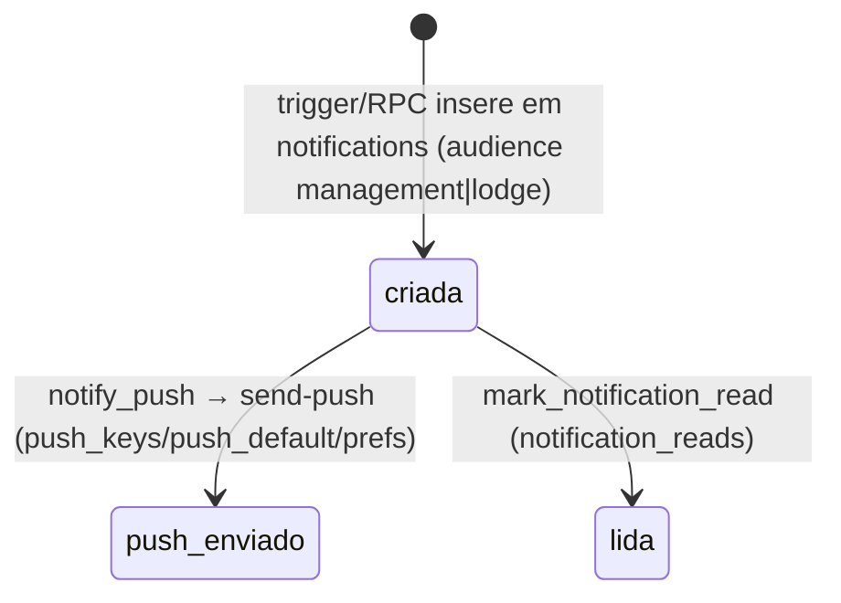
Sem retenção/limpeza identificada.
