# DS Lodge — Manual de telas

Manual de uso do sistema para a equipe dos Lodges **Amiens St.** e **Connolly**. Cada capítulo explica, tela por tela,
para que ela serve, quem usa e **como fazer cada coisa, passo a passo**.

> Endereço do sistema: **https://ds-lodge.vercel.app**
> Os vídeos de cada fluxo estão numerados (01 a 16) e indicados no fim de cada capítulo.

---

## Sumário

1. [Antes de começar](#1-antes-de-começar)
2. [Conceitos que aparecem em todas as telas](#2-conceitos-que-aparecem-em-todas-as-telas)
3. [Quem vê o quê](#3-quem-vê-o-quê)
4. [Hoje](#4-hoje)
5. [Tarefas do turno](#5-tarefas-do-turno)
6. [Residentes](#6-residentes)
7. [Folha do dia (Room Check)](#7-folha-do-dia-room-check)
8. [Seen](#8-seen)
9. [Ausências](#9-ausências)
10. [No Shows](#10-no-shows)
11. [Warnings](#11-warnings)
12. [Mapa de camas](#12-mapa-de-camas)
13. [Handover (Livro Ata)](#13-handover-livro-ata)
14. [Manutenção](#14-manutenção)
15. [Fridge / Temperatura](#15-fridge--temperatura)
16. [Food Delivery](#16-food-delivery)
17. [Dinner](#17-dinner)
18. [Laundry](#18-laundry)
19. [Notificações (gestão)](#19-notificações-gestão)
20. [Rota](#20-rota)
21. [Distribuição](#21-distribuição)
22. [Compras (gestão)](#22-compras-gestão)
23. [Horas (gestão)](#23-horas-gestão)
24. [Férias (gestão)](#24-férias-gestão)
25. [Relatórios (gestão)](#25-relatórios-gestão)
26. [Usuários (gestão)](#26-usuários-gestão)
27. [Auditoria (gestão)](#27-auditoria-gestão)
28. [No celular](#28-no-celular)
29. [Rotina do turno, em resumo](#29-rotina-do-turno-em-resumo)
30. [Problemas comuns e o que significam as mensagens](#30-problemas-comuns-e-o-que-significam-as-mensagens)
31. [Glossário](#31-glossário)

---

## 1. Antes de começar

### Entrar no sistema
1. Abra o endereço do sistema no navegador do computador da recepção.
2. Escolha o idioma no canto superior direito (Português, English ou Polski). A escolha fica gravada no seu cadastro.
3. Digite o **e-mail** e a **senha** e clique em **Entrar**.

> Use sempre a sua própria conta. Nunca entre em nome de outra pessoa: tudo o que você registra fica com o seu nome.

### Primeiro acesso
- A senha que a gestão entregou é **provisória**. O sistema pede uma nova senha na hora.
- A nova senha precisa ter **pelo menos 10 caracteres, com letras e números**.
- Repita a senha e clique em **Salvar**.

### Segunda etapa da gestão (Manager, Owner e Developer)
Quem é da gestão confirma a entrada com um **código enviado por e-mail** (não é preciso aplicativo autenticador).
1. Depois da senha, clique em **Enviar código**.
2. Abra o e-mail e clique no link (ou digite o código) para concluir.
3. Se o e-mail demorar, espere alguns minutos antes de pedir outro; o envio tem limite por hora.

Porter não tem segunda etapa: entra só com e-mail e senha.

### Assumir o posto
Antes de registrar qualquer coisa, o Porter precisa **assumir o posto do turno**.
1. Na tela **Assumir Posto**, escolha a função: **Office On Duty** (fica em um Lodge) ou **Float** (cobre os dois Lodges).
2. Se for Office, escolha o **Lodge**.
3. Clique em **Assumir Posto**.
4. Se o posto já tiver dono, o sistema mostra **quem é e desde quando**. Só troque se tiver certeza: ao confirmar, o posto da outra pessoa é encerrado.

Para sair do posto, clique no seu posto (no topo da tela, onde aparece “Você é Office On Duty…”) e depois em **Encerrar meu posto**. **Continuar sem posto** deixa você apenas ver as telas, sem registrar.

### Sair e inatividade
- Clique em **Sair** quando terminar.
- Por segurança, se ficar **15 minutos sem usar o sistema**, ele encerra a sessão sozinho. É só entrar de novo.

🎥 Vídeos: **01** (acesso da gestão) e **02** (assumir o posto).

---

## 2. Conceitos que aparecem em todas as telas

| Termo | O que é |
|---|---|
| **Dia operacional** | Vai das **07:00 às 07:00** do dia seguinte. Tudo o que acontece de madrugada pertence ao dia que começou às 07:00. |
| **Turno Day / Night** | Day: 07:00–19:00. Night: 19:00–07:00. |
| **Office On Duty** | A pessoa que responde por um Lodge no turno. |
| **Float** | A pessoa que cobre os dois Lodges (das 12h às 24h). |
| **Check (Room Check)** | A conferência de todos os residentes, lançada em **12:00, 18:00 e 22:00**. |
| **Ronda** | O registro de “Room Check Done” no Handover, **de 2 em 2 horas**. |
| **Seen** | Evidência de que o residente foi visto: por check, por visto manual, por entrada (check-in) ou pelo Dinner. |
| **Ausência comunicada** | O residente avisou que vai sair. A cama continua dele e não haverá No Show no período. |
| **No Show** | Residente sem nenhuma evidência de presença no dia, confirmado pela lista final. |
| **Out** | Saída do residente. Office/Float **decidem**; Manager/Owner **efetivam**. |
| **Warning** | Advertência: Verbal, Written ou Final Written (FW). |
| **FW** | Final Written Warning. Aparece como marca vermelha ao lado do nome. |
| **Handover** | O diário oficial do Lodge: tudo o que acontece no turno. |

Horários são sempre mostrados no **horário de Dublin**.

---

## 3. Quem vê o quê

| Tela | Porter (Office/Float) | Manager / Owner / Developer |
|---|:---:|:---:|
| Hoje, Tarefas do turno | ✔ | ✔ |
| Residentes, Folha do dia, Seen, Ausências, No Shows, Warnings, Mapa de camas | ✔ | ✔ |
| Handover, Manutenção | ✔ | ✔ (altera status) |
| Fridge, Food Delivery, Dinner, Laundry | ✔ | ✔ (fecha sobras do Dinner) |
| Rota | vê só o **publicado** | monta e publica |
| Distribuição | ✔ (sem preços) | ✔ |
| Notificações, Compras, Horas, Férias, Relatórios, Usuários, Auditoria | — | ✔ |

Regras gerais:
- **Porter só registra no Lodge do seu posto** (o Float registra nos dois). Em outro Lodge, ele apenas vê.
- **Preços e notas de compra** só a gestão vê.
- Há uma **janela de correção de 72 horas** para anotações e registros: depois disso, só Manager ou Owner corrigem.

---

## 4. Hoje

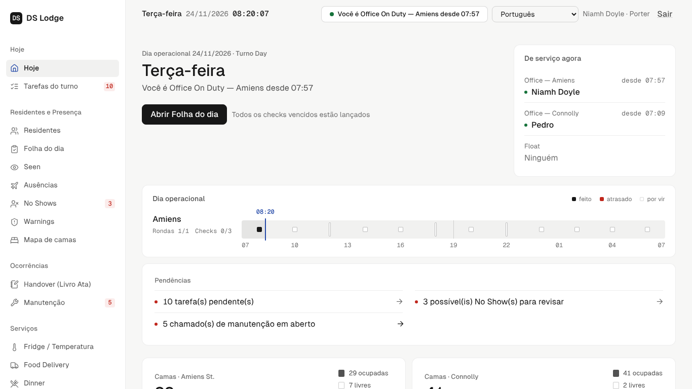

**Para que serve:** é a tela inicial. Mostra o que importa **agora**.

O que aparece:
- **Cabeçalho do turno:** dia operacional, turno (Day/Night), o seu posto e o botão da **próxima ação** (por exemplo “Lançar check 12:00”).
- **De serviço agora:** quem está no Office de cada Lodge e no Float, com o horário em que assumiu.
- **Dia operacional (a régua):** uma linha de 07:00 a 07:00 para cada Lodge. Cada marca é uma ronda ou um check:
  - quadrado **preto** = feito;
  - **vermelho** = atrasado;
  - **vazado** = por vir;
  - a linha **azul** é o “agora”.
- **Pendências:** o que está esperando alguém, com link direto: checks por lançar, rondas esquecidas, tarefas, possíveis No Shows, ausências com retorno vencido e chamados em aberto. Clique em uma linha para ir à tela certa.
- **Quadro de camas:** cada quarto com as suas camas — ocupada (cinza), livre (vazada), com Out decidido (âmbar), fora de uso (hachurada). Uma linha vermelha na célula marca um residente com FW. Clique no quadro para abrir o **Mapa de camas**.

**Como usar:** olhe a régua e as pendências no começo de cada turno e resolva de cima para baixo.

---

## 5. Tarefas do turno

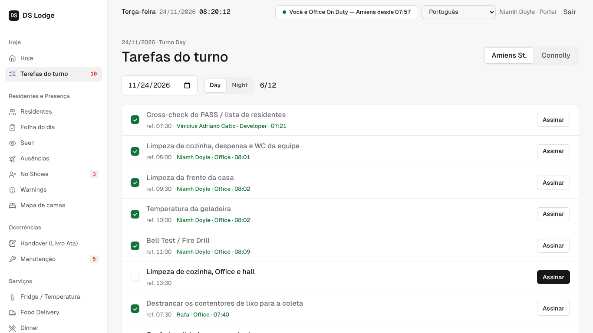

**Para que serve:** a lista de tarefas do turno, **do modelo de cada Lodge**, nos 3 idiomas.

**Assinar uma tarefa**
1. Abra **Tarefas do turno**.
2. Clique em **Assinar** na tarefa feita.
3. A assinatura registra **seu nome, função e hora**.

**Quando entrar no sistema**, um aviso lista as tarefas esperando por você. **Abrir tarefas** leva à lista; **Depois** fecha o aviso (ele volta).

**Tarefas pendentes**
- Tarefa sem assinatura **não some**: aparece em **Ainda pendentes** e fica marcada como atrasada depois que o turno termina.

**Tarefa extra (gestão)**
1. Clique em **Tarefa extra**.
2. Escreva a tarefa, escolha **Para** (uma pessoa ou **O turno todo**) e, se quiser, o **Prazo**.
3. Clique em **Criar**. Todos os que estiverem no turno enxergam a tarefa.

**Tarefa da geladeira:** é assinada **sozinha** quando alguém registra a temperatura na tela Fridge (capítulo 15).

🎥 Vídeos: **08** (assinar) e **12** (tarefas extras).

---

## 6. Residentes

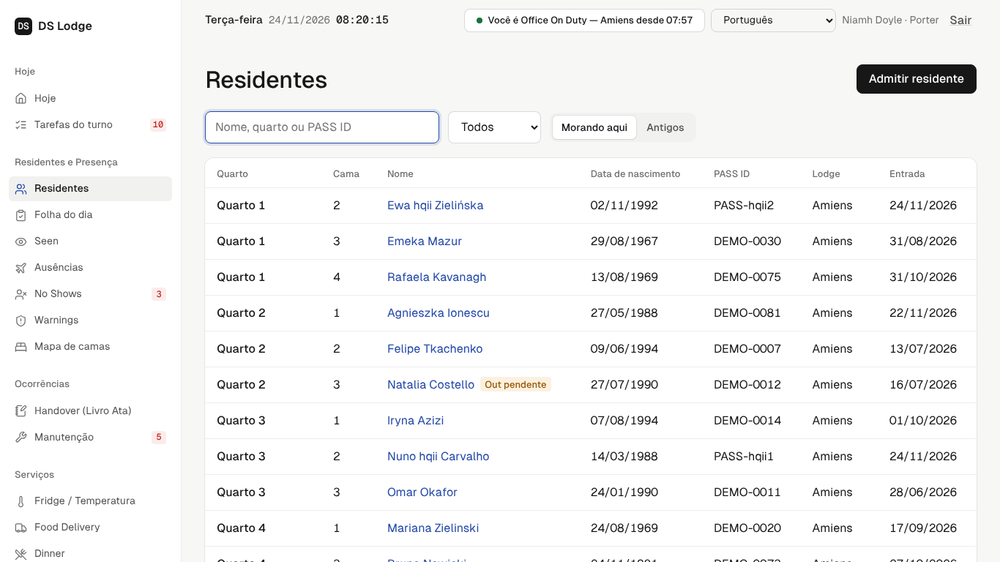

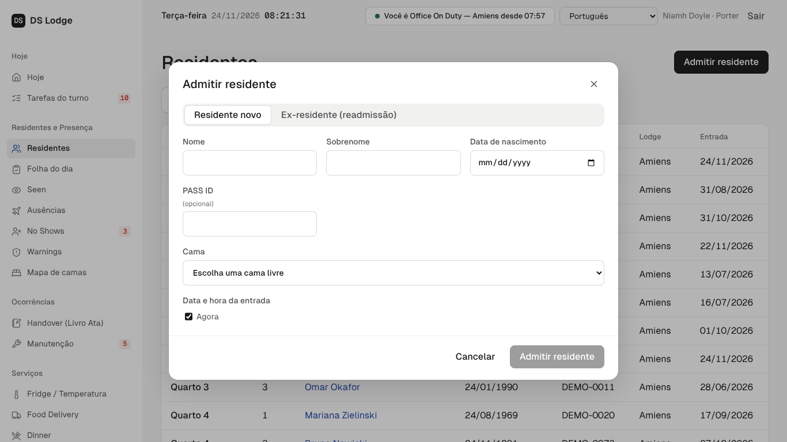

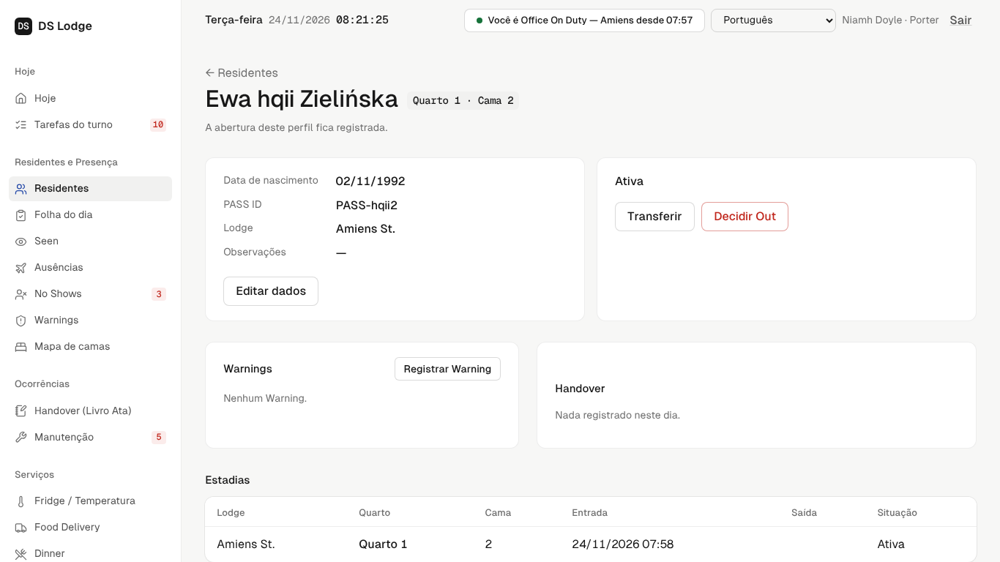

**Para que serve:** o cadastro de todos os residentes, atuais e antigos.

### Procurar
1. Digite no campo de busca: **nome, quarto ou PASS ID**. A lista filtra enquanto você digita.
2. Use os filtros de **Lodge** e **Situação** (**Morando aqui** ou **Antigos**).

### Admitir um residente
1. Clique em **Admitir residente**.
2. Escolha **Residente novo** (ou **Ex-residente (readmissão)** para quem já esteve aqui).
3. Preencha **Nome** e **Sobrenome**. **Data de nascimento** e **PASS ID** são opcionais.
4. Em **Cama**, escolha uma **cama livre**. A lista mostra só as camas livres do seu Lodge.
5. Em **Data e hora da entrada**, deixe **Agora** marcado, ou desmarque e informe a data e a hora.
6. Clique em **Admitir residente**.

O sistema abre o perfil do residente e avisa: **a abertura de cada perfil fica registrada** (auditoria).

### Perfil do residente
No perfil você vê: dados, a estadia atual, **Warnings** e **ocorrências** do Handover em que ele foi marcado, e o histórico de estadias.
- **Editar dados:** corrige nome, nascimento, PASS ID e observações.
- **Transferir:** muda o residente de cama (capítulo abaixo).
- **Decidir Out / Retirar Out / Efetivar Out:** saída do residente.
- **Registrar Warning:** abre o formulário de advertência.

### Decidir Out (Office, Float)
1. No perfil, clique em **Decidir Out**.
2. Escreva o **Motivo** (obrigatório).
3. Confirme. A estadia passa a **Out pendente** e **a cama continua ocupada**.
4. Se mudar de ideia, **Retirar Out** (antes de efetivar).

### Efetivar Out (Manager, Owner)
1. No perfil do residente com Out pendente, clique em **Efetivar Out**.
2. Confirme a data e a hora e clique em **Efetivar**.
3. A estadia é **encerrada** e a **cama fica livre**. O cadastro do residente é mantido (aparece em **Antigos**).

### Transferir de cama
1. No perfil, clique em **Transferir**.
2. Escolha a **nova cama livre** (pode ser em outro Lodge).
3. Confirme. A estadia antiga é encerrada como **Transferência** e uma nova começa. O histórico não se perde e **a contagem de No Shows do mês continua** (transferir não zera).

🎥 Vídeos: **03** (admissões e Out) e **11** (transferência e efetivar Out).

---

## 7. Folha do dia (Room Check)

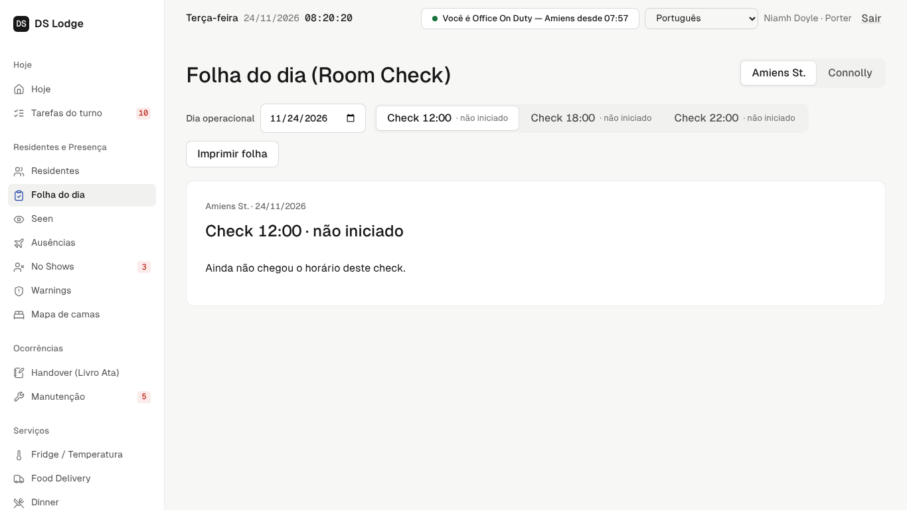

**Para que serve:** lançar os **checks de 12:00, 18:00 e 22:00**: de cada cama, quem foi visto.

### Lançar um check
1. Abra **Folha do dia** e escolha o **Lodge** (no topo).
2. Confira o **Dia operacional** (por padrão, o de hoje).
3. Clique na aba do check (**Check 12:00**, **Check 18:00** ou **Check 22:00**). Cada aba mostra a situação: **não iniciado**, **por lançar** ou **lançado**.
4. Clique em **Começar a lançar** (ou **Continuar**, se já tiver começado).
5. Confira o **Horário real do check** e **Quem fez a ronda** (se foi outra pessoa que fez a ronda e você está digitando, escolha o nome dela).
6. Marque **cada residente**:
   - **Visto**
   - **Não visto**
   - **Ausência** (só habilita para quem tem ausência comunicada)
7. Quando todos estiverem marcados, clique em **Lançar check**. A mensagem **Check lançado.** confirma.

### Pelo teclado (mais rápido)
Clique na primeira linha e use:

| Tecla | O que faz |
|---|---|
| **V** | Visto (e vai para a próxima linha) |
| **N** | Não visto |
| **A** | Ausência |
| **↑ / ↓** | Muda de linha |
| **Delete** | Limpa a marca |

A barra de baixo mostra o progresso (“21 de 35 marcados”). **Só dá para lançar quando todos estão marcados.**

### Residente com ausência comunicada
Se você marcar **Visto** alguém que tem ausência ativa, o sistema pergunta **“Deseja antecipar a presença deste residente?”**:
- **Sim, registrar o retorno agora**: encerra a ausência e conta como presente.
- **Não, manter a ausência**: nada muda; marque como **Ausência**.

### Regras importantes
- Um check pode ser lançado até **1 hora antes** do horário. Antes disso aparece “Ainda não chegou o horário deste check”.
- Se a folha **já foi lançada**, o sistema avisa e **nada é duplicado**.
- Se aparecer “Você pode ver esta folha, mas não lançar”, você está vendo **outro Lodge** ou está **sem posto**.

### Imprimir a folha
**Imprimir folha** abre a folha de papel (número, quartos, residentes atuais e linhas em branco para admissões). Use quando o sistema estiver fora do ar; **imprimir não confirma nada**. Depois, lance os dados no sistema.

🎥 Vídeo: **04**.

---

## 8. Seen

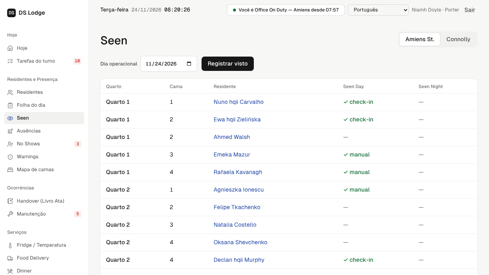

**Para que serve:** ver, de cada residente, se foi **visto no turno Day** e **no turno Night**, e **por qual origem** (check, visto manual, check-in ou Dinner).

**Registrar um visto manual** (“Vi este residente”)
1. Abra **Seen** e confira o **Lodge** e o **dia**.
2. Clique em **Registrar visto**.
3. Escolha o **Residente** (aparecem só os que estão no Lodge agora).
4. Ajuste **Quando** (por padrão, agora) e, se quiser, **Onde** (Recepção, Cozinha, Jardim…).
5. Clique em **Salvar**. A mensagem **Visto registrado.** confirma.

Um visto manual vale como **evidência de presença** no turno e **evita No Show**.

🎥 Vídeo: **05**.

---

## 9. Ausências

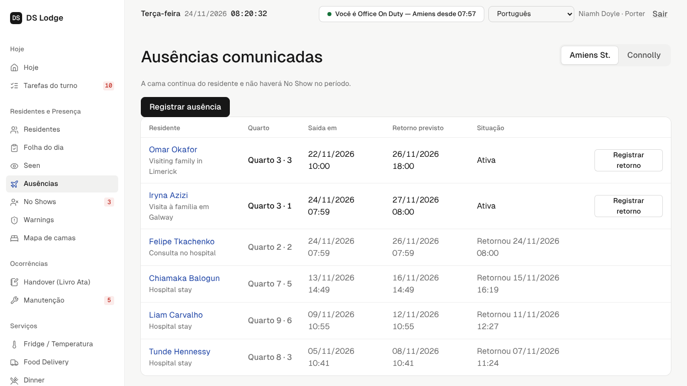

**Para que serve:** registrar quando o residente avisa que vai sair.

**Registrar uma ausência**
1. Abra **Ausências** e clique em **Registrar ausência**.
2. Escolha o **Residente**.
3. Confira **Saída em** e informe o **Retorno previsto**.
4. Se quiser, escreva uma **Observação** (hospital, visita à família…).
5. Clique em **Salvar**.

Enquanto a ausência está ativa, **a cama continua do residente e não haverá No Show**.

**Registrar o retorno**
1. Na linha da ausência, clique em **Registrar retorno**.
2. Confirme a **Hora do retorno** e clique em **Salvar**.

**Retorno vencido:** se passar do retorno previsto sem o residente voltar, a ausência fica marcada como **Retorno vencido** e entra nas **Pendências** de Hoje. Procure o residente, registre o retorno ou ajuste a situação.

🎥 Vídeo: **05**.

---

## 10. No Shows

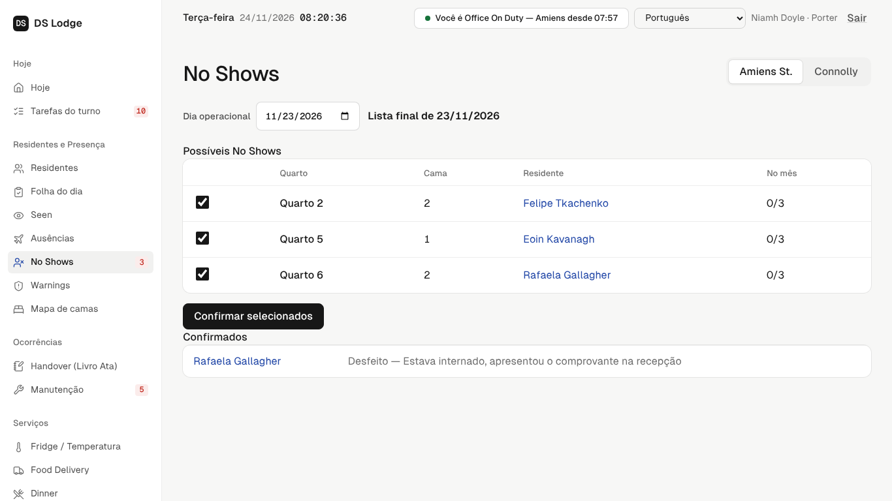

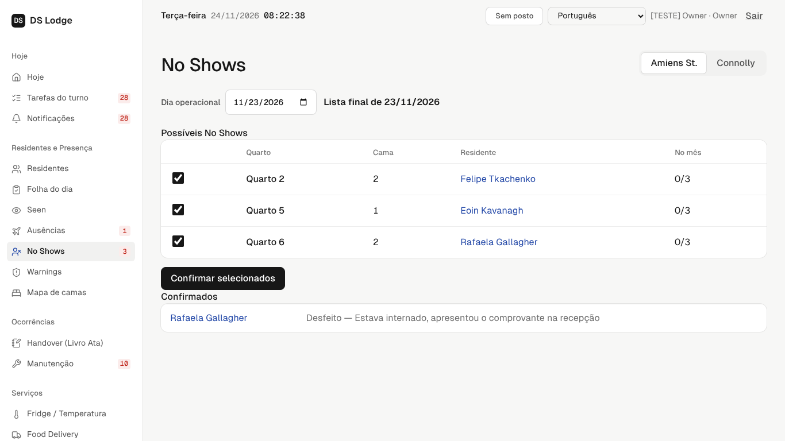

**Para que serve:** a lista final do dia que terminou: quem **não teve nenhuma evidência de presença**.

**Quando abre:** a lista de cada dia fica pronta **às 06h30**. Antes disso aparece “O dia ainda não terminou”.

**Confirmar No Shows**
1. Abra **No Shows**. A lista mostra os **Possíveis No Shows** do dia anterior, com o contador **No mês** de cada residente.
2. Se aparecer **“Lista incompleta: checks por lançar”**, volte à **Folha do dia** e lance os checks que faltam: **a confirmação fica bloqueada** até lá.
3. Antes de confirmar, **procure** quem aparece na lista: se alguém foi visto, registre o **Seen** ou corrija o check.
4. Marque a caixa de cada residente que realmente não apareceu.
5. Clique em **Confirmar selecionados**. A mensagem **No Shows confirmados.** confirma.

**3º No Show no mês:** o sistema avisa **Manager e Owner** (“chegou a 3 No Shows no mês”). O contador mostra o número do mês (por exemplo 2/3) e a decisão sobre o Out é da gestão.

**Desfazer um No Show** (Manager/Owner)
1. Na seção **Confirmados**, clique em **Desfazer**.
2. Escreva o **Motivo** e confirme. O registro fica **Desfeito**, **com histórico**.

**Aviso das 18h30:** às 18h30 o sistema mostra, na tela Hoje, quem ainda **não tem evidência de presença no dia**. Procure, corrija e marque. Esse aviso **não registra nada**.

🎥 Vídeo: **11**.

---

## 11. Warnings

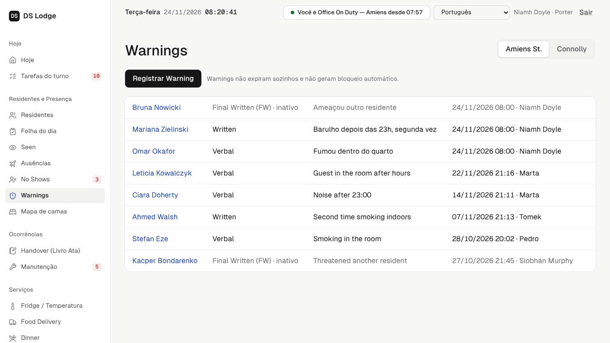

**Para que serve:** registrar advertências: **Verbal**, **Written** e **Final Written (FW)**.

**Registrar um Warning**
1. Abra **Warnings** (ou o perfil do residente) e clique em **Registrar Warning**.
2. Escolha o **Residente**, o **Tipo** e escreva **O que aconteceu**.
3. Clique em **Registrar**. O Warning vai para o **Handover** e para o **perfil**.

**Final Warning (FW)**
- Aparece como uma marca **FW** vermelha ao lado do nome do residente na folha, no perfil e no mapa de camas.
- **Warnings não expiram sozinhos** e **não geram bloqueio automático**.
- Só a **gestão desativa** um FW, **sempre com motivo**: botão **Desativar FW**.

🎥 Vídeos: **06** (registrar) e **11** (desativar FW).

---

## 12. Mapa de camas

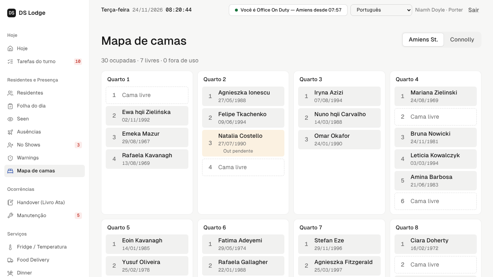

**Para que serve:** ver todas as camas de cada Lodge, quarto por quarto.

- Cada cama mostra o residente (ou **Cama livre**).
- Marcas: **Out pendente**, **Fora de uso**, **Protegida por ausência**.

**Marcar uma cama fora de uso** (e voltar ao uso)
1. Clique em uma **cama livre**.
2. Para tirar de uso, escreva a **Observação** (por exemplo “Cabeceira quebrada”) e clique em **Marcar fora de uso**.
3. Para devolver, clique na cama hachurada e em **Voltar ao uso**.

Camas fora de uso **não aparecem** na lista de camas livres para admissão.

🎥 Vídeo: **11**.

---

## 13. Handover (Livro Ata)

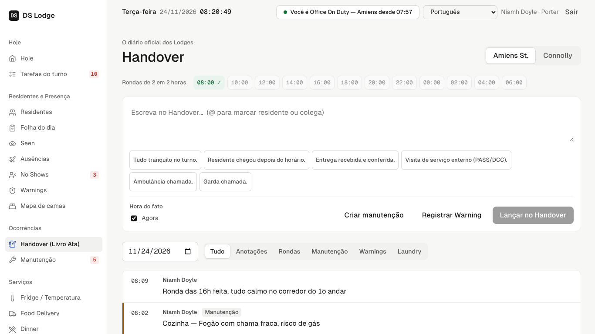

**Para que serve:** o **diário oficial** dos Lodges. Tudo o que acontece no turno é anotado aqui.

### Escrever uma anotação
1. Abra **Handover** e confira o **Lodge**.
2. No campo de texto, escreva o que aconteceu.
3. Digite **@** para **marcar um residente ou um colega**. Escolha na lista. A anotação passa a aparecer no perfil do residente.
4. **Frases rápidas** (botões abaixo do campo) inserem textos prontos.
5. Em **Hora do fato**, deixe **Agora**, ou desmarque e informe a hora em que o fato aconteceu.
6. Clique em **Lançar no Handover**.

**Lançamento depois do turno:** se o fato é de um turno que já terminou, o sistema pede o **Motivo do lançamento depois do turno** (por exemplo “Esqueci de registrar”). Escolha um da lista.

### Rondas (de 2 em 2 horas)
- No alto da tela há os horários das rondas (08:00, 10:00, 12:00…).
- Clique no horário da ronda que você fez: o sistema registra **“Room Check Done”**.
- Ronda que passou e não foi registrada aparece como **ronda esquecida** e entra nas Pendências.
- Lançar um **check** na Folha do dia já registra a ronda daquele horário.

### Filtros
As abas **Tudo, Anotações, Rondas, Manutenção, Warnings** e **Laundry** filtram o dia. O **campo de data** muda o dia que você está vendo.

### Atalhos dentro do Handover
- **Criar manutenção**: abre um chamado (capítulo 14).
- **Registrar Warning**: abre o formulário de advertência (capítulo 11).

### Corrigir e anular
- Passe o mouse sobre a **sua** anotação e use **Corrigir** (muda o texto) ou **Anular** (exige **Motivo da anulação**).
- Nada é apagado: a anotação anulada fica riscada, com o motivo.
- Depois de **72 horas**, só Manager ou Owner corrigem.

🎥 Vídeo: **07**.

---

## 14. Manutenção

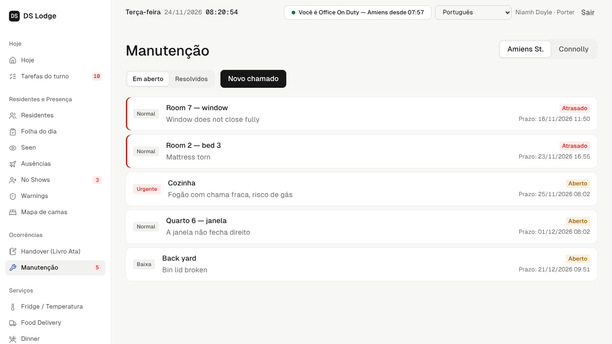

**Para que serve:** chamados de conserto. Qualquer Porter abre; a gestão acompanha.

### Abrir um chamado
1. Abra **Manutenção** e clique em **Novo chamado** (ou use **Criar manutenção** no Handover).
2. Preencha **Local** (por exemplo “Quarto 6 — janela”) e **Descrição**.
3. Escolha a **Prioridade**: **Urgente** (prazo de 24 horas), **Normal** (7 dias) ou **Baixa** (30 dias). O **prazo sugerido** aparece na tela.
4. Clique em **Criar**. A mensagem **Chamado criado — o Manager foi avisado.** confirma. O chamado também vira uma anotação no Handover.

### Acompanhar (gestão)
1. Clique no chamado.
2. Escolha o **Status**: **Aberto**, **Em andamento**, **Em espera**, **Resolvido** ou **Reaberto**.
3. Se quiser, defina um **Novo prazo** e escreva **O que foi feito**.
4. Clique em **Atualizar**.

Cada mudança fica no **Histórico** do chamado. As abas **Em aberto** e **Resolvidos** separam os chamados.

### Prazo vencido
Quando o prazo passa, a gestão vê um aviso **“Prazo vencido — qual é o status?”** ao entrar, com as opções: **Resolvido**, **Em andamento (novo prazo)**, **Em espera (com observação)** ou **Lembrar em 24 h**.

🎥 Vídeos: **08** (abrir chamados) e **12** (atualizar status).

---

## 15. Fridge / Temperatura

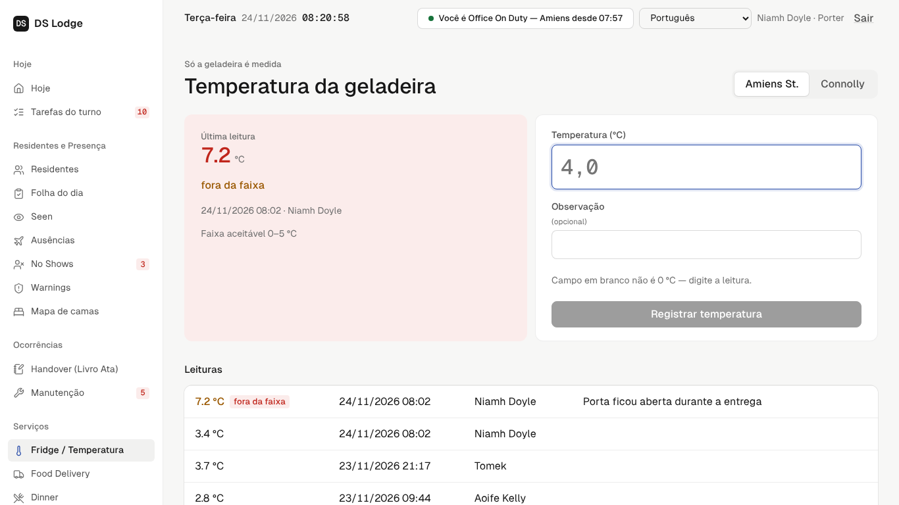

**Para que serve:** registrar a temperatura da geladeira. **Só a geladeira é medida.**

1. Abra **Fridge / Temperatura**.
2. Digite a **Temperatura (°C)** (aceita vírgula: 3,4). **Campo em branco não vale como 0 °C.**
3. Se quiser, escreva uma **Observação**.
4. Clique em **Registrar temperatura**.

- **Dentro da faixa (0 a 5 °C):** a tarefa **“Temperatura da geladeira”** do turno é **assinada sozinha**.
- **Fora da faixa:** o sistema avisa na hora (**“Fora da faixa — o Manager foi avisado.”**) e manda **notificação à gestão**.

A tela mostra a **última leitura** e o histórico.

🎥 Vídeo: **09**.

---

## 16. Food Delivery

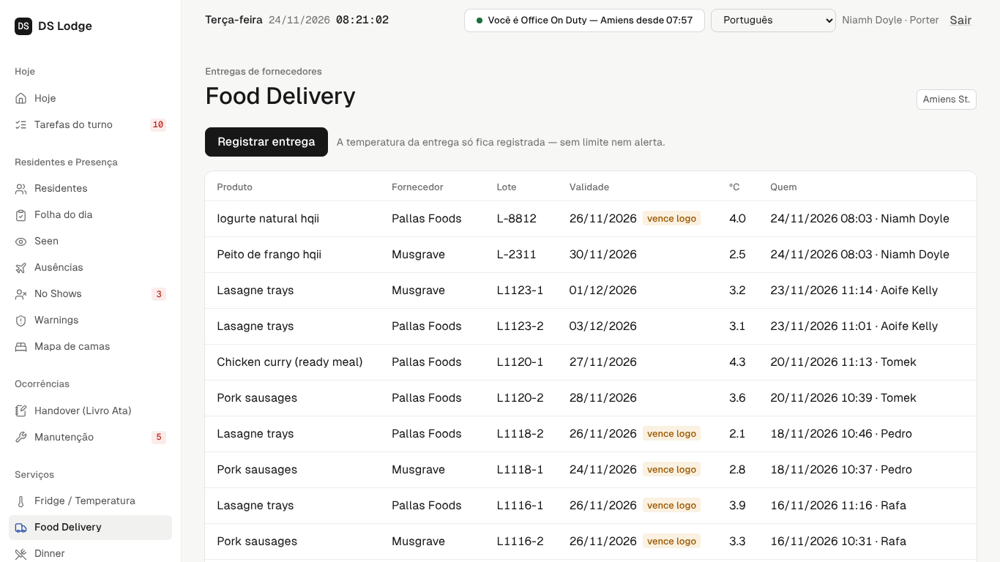

**Para que serve:** registrar as **entregas de fornecedores** (só no Lodge que tem cozinha, o Amiens).

1. Abra **Food Delivery** e clique em **Registrar entrega**.
2. Preencha **Produto**, **Fornecedor**, **Lote**, **Validade** e **Temperatura (°C)**.
3. Clique em **Salvar**. A mensagem **Entrega registrada.** confirma.

- A temperatura da entrega **só fica registrada** (não há alerta).
- Validade próxima aparece destacada como **“vence logo”**.

🎥 Vídeo: **09**.

---

## 17. Dinner

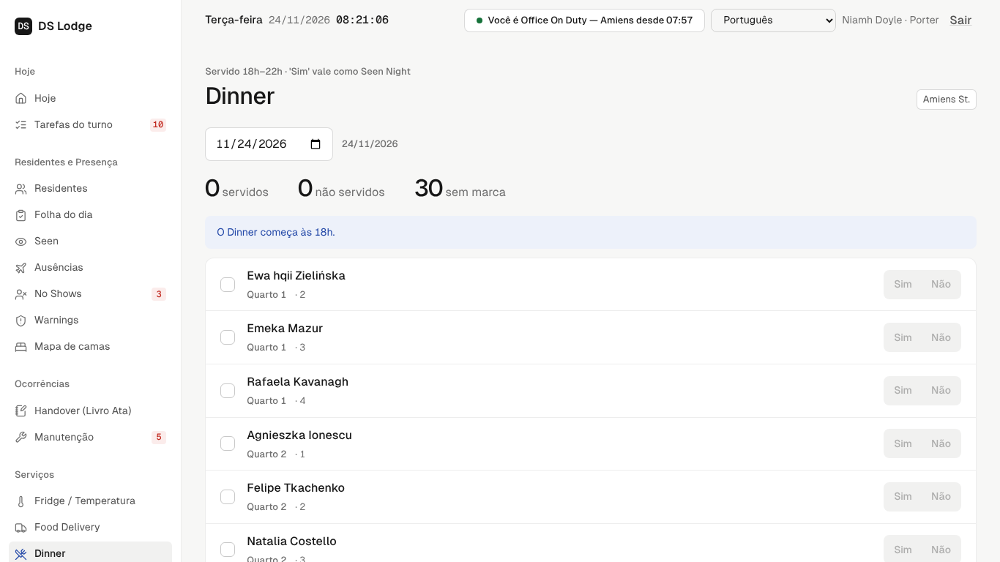

**Para que serve:** marcar quem jantou. O Dinner é servido **das 18h às 22h**, só no Lodge com cozinha (Amiens).

**Marcar**
1. Abra **Dinner** e confira o **dia**.
2. Em cada residente, clique em **Sim** (jantou) ou **Não**.
3. **“Sim” vale como Seen Night**: conta como evidência de presença e tira o residente da lista de No Show.

Antes das 18h os botões ficam bloqueados (“O Dinner começa às 18h.”).

**Fechar as sobras (gestão, depois das 22h)**
1. Clique em **Fechar sobras**.
2. Informe as **Porções de sobra** e as **Embalagens** (embalagens **não são** pessoas atendidas) e, se quiser, uma **Observação**.
3. Confirme. Depois de fechado, **só o Owner (ou Developer)** edita as sobras (**Editar sobras**).

🎥 Vídeo: **09**.

---

## 18. Laundry

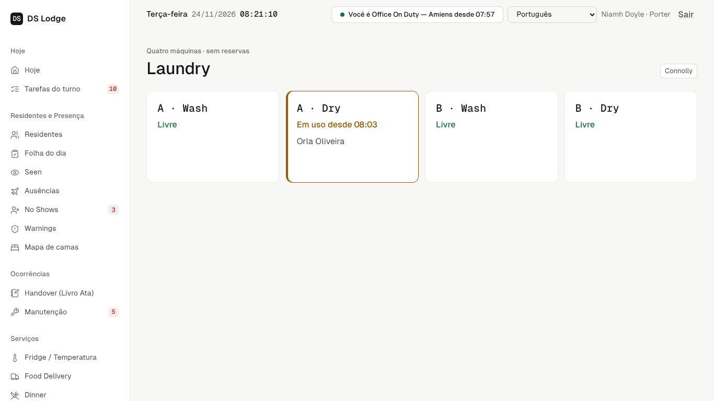

**Para que serve:** controlar as **4 máquinas** da lavanderia (**A·Wash, A·Dry, B·Wash, B·Dry**), só no Connolly. **Não há reservas.**

1. Abra **Laundry**.
2. Em uma máquina **Livre**, clique em **Iniciar**.
3. Escolha o **Residente** (ou **Sem residente (uso da equipe)**) e clique em **Iniciar**.
4. A máquina passa a mostrar **“Em uso desde …”** e o residente. **Iniciar anota no Handover.**
5. Quando terminar, clique em **Finalizar**. A máquina fica livre (**finalizar não gera outra anotação**).

Uma máquina em uso **não pode ser iniciada de novo**.

🎥 Vídeo: **10**.

---

## 19. Notificações (gestão)

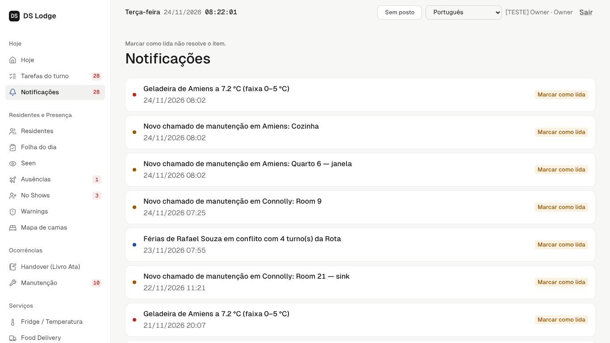

**Para que serve:** os avisos que o sistema envia à gestão:
- **Geladeira fora da faixa**
- **Novo chamado de manutenção**
- **3º No Show do mês**
- **Rota publicada abaixo da cobertura mínima**
- **Férias em conflito com a Rota**

**Como usar**
1. Abra **Notificações**.
2. Clique em **Marcar como lida** quando tratar o aviso.

**Marcar como lida não resolve o item**: o problema segue nas telas dele até ser resolvido.

🎥 Vídeo: **12**.

---

## 20. Rota

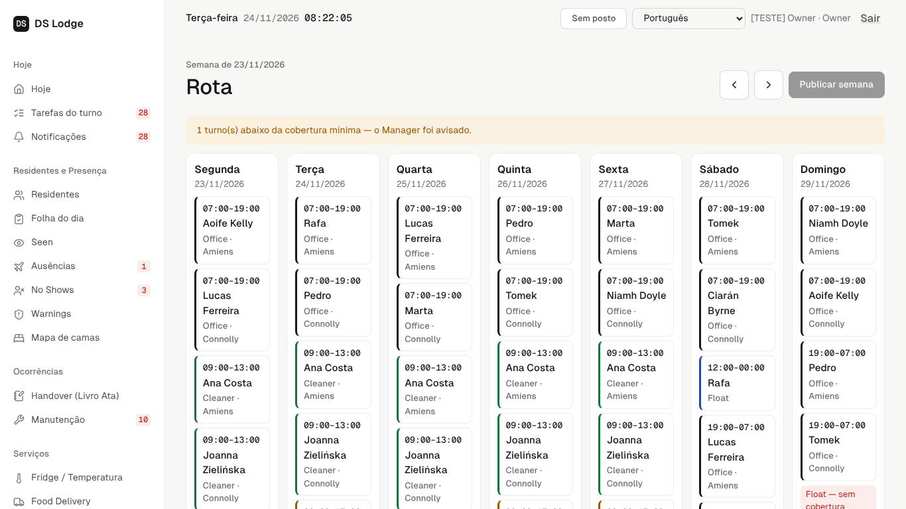

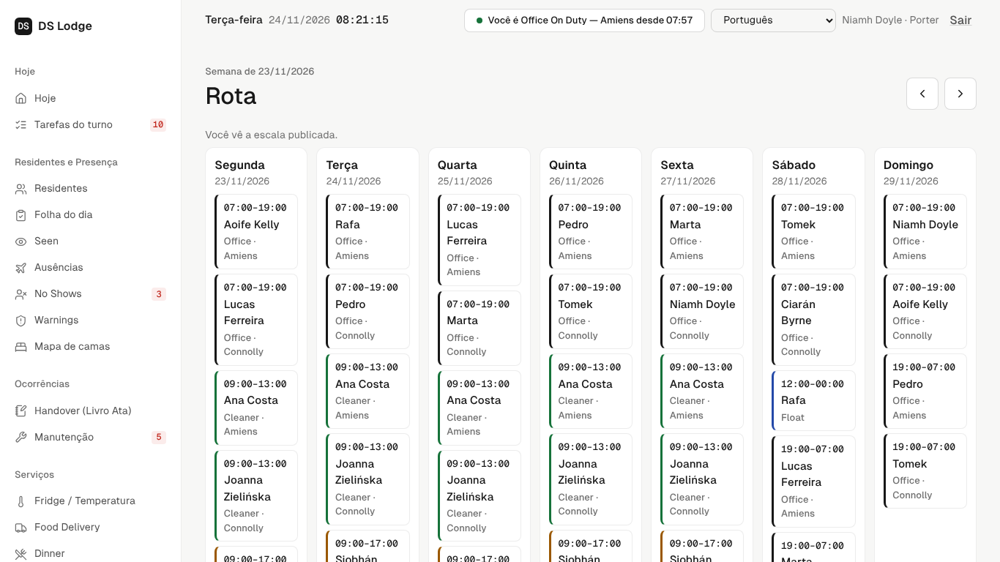

**Para que serve:** a escala semanal (**Day, Night, Float, Cleaners e Manager**).

### Para a equipe
Você vê **a escala publicada**. Rascunhos não aparecem.

### Para a gestão
1. Abra **Rota** e use as setas **Semana anterior / Próxima semana**.
2. **Buracos de cobertura** aparecem em **vermelho**, por exemplo “Float — sem cobertura”.
3. Clique em **Adicionar turno** no dia desejado.
4. Escolha a **Função** (**Office, Float, Cleaner** ou **Manager**). Para Office, escolha **Day 07–19** ou **Night 19–07**.
5. Escolha a **Pessoa**: o sistema só oferece quem pode assumir aquela função (Office: Porter; Float: Porter ou Manager; Cleaner: Cleaner).
6. Escolha o **Lodge** (Float não tem Lodge), o **Dia** e os horários. Um fim menor que o início vale para o **dia seguinte** (Night, Float).
7. Clique em **Salvar**. O turno entra como **rascunho**.
8. Para tirar um turno, clique nele e em **Remover turno**.
9. Quando a semana estiver pronta, clique em **Publicar semana**. O sistema avisa quantos turnos foram publicados e se ainda há **cobertura abaixo do mínimo** (nesse caso a gestão recebe uma notificação).

**Recusas comuns**
- “Esta pessoa já tem um turno neste horário.”
- “Já existe um Float na escala neste horário.”
- “O cargo desta pessoa não permite esta função.”

**Cobertura mínima:** 1 Office por turno e por Lodge e 1 Float das 12h à meia-noite.

🎥 Vídeo: **13**.

---

## 21. Distribuição

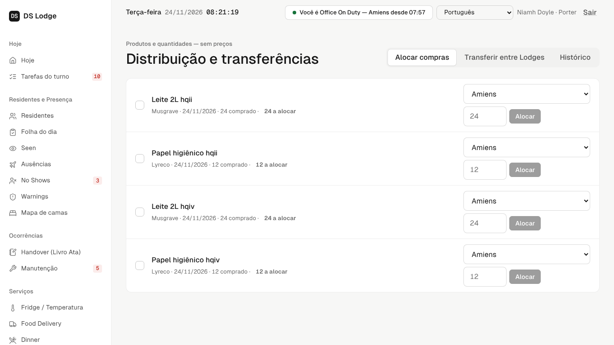

**Para que serve:** repartir as **compras** entre os Lodges e **transferir produtos** de um Lodge para o outro. **Aqui ninguém vê preços.**

### Alocar uma compra
1. Abra **Distribuição**, aba **Alocar compras**.
2. Em cada produto comprado aparece **“N a alocar”**.
3. Escolha o Lodge em **Para**, digite a **quantidade** e clique em **Alocar**.
4. **Não dá para alocar mais do que foi comprado.**

### Transferir entre Lodges
1. Aba **Transferir entre Lodges**.
2. Escolha o **Produto**, **De**, **Para**, a **quantidade** e, se quiser, uma **Observação**.
3. Clique em **Transferir**. **Transferência não é nova despesa.**

A aba **Histórico** lista todas as alocações e transferências, com quem fez e quando.

🎥 Vídeo: **14**.

---

## 22. Compras (gestão)

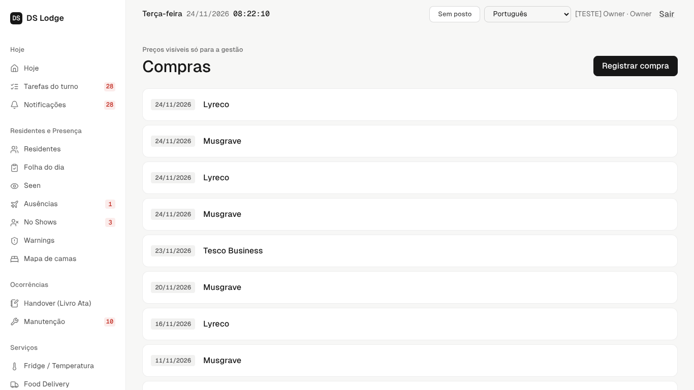

**Para que serve:** registrar as compras dos fornecedores. **Preços e notas só a gestão vê.**

1. Abra **Compras** e clique em **Registrar compra**.
2. Preencha **Fornecedor**, **Data** e, se tiver, a **Nota / documento**.
3. Em cada linha, escolha o **Produto** (ou digite o nome de um **produto novo**), a **Qtd.** e o **Preço unit. (€)**.
4. O **total da linha** aparece na hora e é **arredondado ao centavo** (meio centavo sobe). Exemplo: 24 × 1,335 € = 32,04 €.
5. Use **Adicionar linha** para mais produtos e clique em **Salvar**.

Para ver as linhas e os preços de uma compra, clique nela na lista.

🎥 Vídeo: **14**.

---

## 23. Horas (gestão)

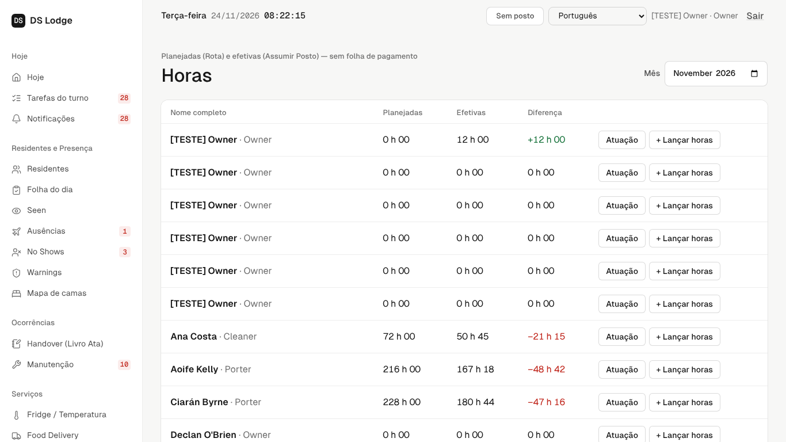

**Para que serve:** comparar as **horas planejadas** (Rota) com as **efetivas** (posto assumido). **Não é folha de pagamento.**

1. Abra **Horas** e escolha o **Mês**.
2. Cada pessoa mostra **Planejadas**, **Efetivas** e a **Diferença** (vermelha = trabalhou menos; verde = mais).
3. Clique em **Atuação** para ver, dia a dia, de onde vêm as horas (posto assumido ou lançamento da gestão).

**Ajustar um posto** (esqueceu de assumir, ou encerrou depois)
1. Em **Atuação**, clique em **Ajustar** no posto.
2. Corrija o **início** e o **fim** e escreva o **Motivo** (obrigatório).
3. Clique em **Salvar**. O **histórico fica guardado**.

**Lançar horas** (cleaners e Manager, que não assumem posto)
1. Clique em **Lançar horas** na linha da pessoa.
2. Informe início e fim e, se quiser, uma observação.
3. Limites: **até 24 horas** por lançamento e **não no futuro**.

🎥 Vídeo: **13**.

---

## 24. Férias (gestão)

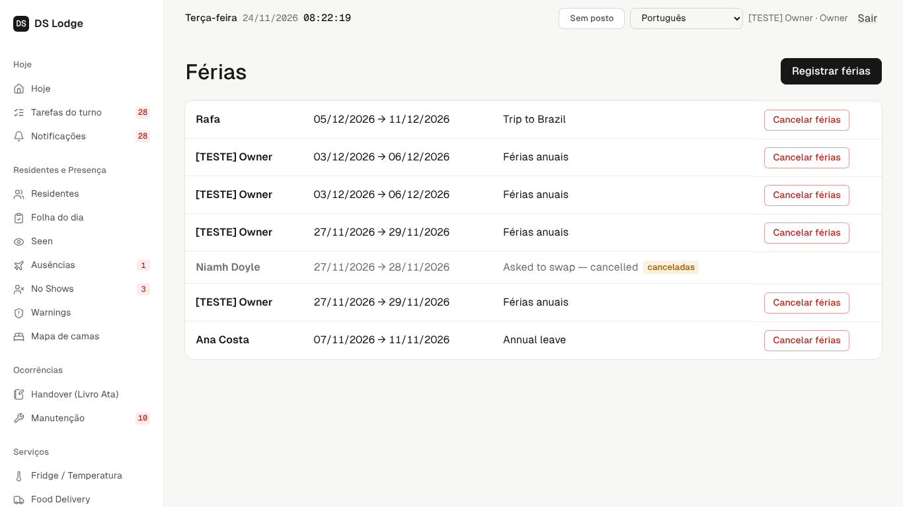

**Para que serve:** registrar as férias da equipe.

1. Abra **Férias** e clique em **Registrar férias**.
2. Escolha a **Pessoa** e as datas **De** e **Até**, com uma **Observação** se quiser.
3. Clique em **Salvar**.

Se as férias **coincidem com turnos da Rota**, o sistema mostra **“Conflito: N turno(s) da Rota neste período”** e **avisa a gestão**: ajuste a Rota.

Para desfazer, use **Cancelar férias** na linha.

🎥 Vídeo: **13**.

---

## 25. Relatórios (gestão)

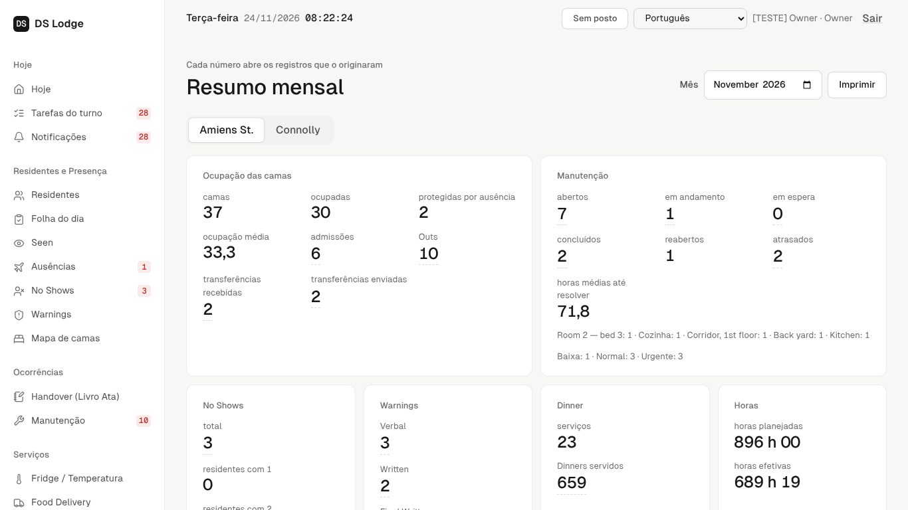

**Para que serve:** o **resumo mensal por Lodge**.

1. Abra **Relatórios**, escolha o **Lodge** e o **Mês**.
2. Os blocos aparecem na ordem: **Ocupação das camas, Manutenção, No Shows, Warnings, Dinner, Laundry, Horas, Tarefas diárias, Rondas e checks, Temperatura, Movimentação de residentes, Lançamentos fora do turno e Cobertura da escala**.
3. **Cada número sublinhado abre os registros que o formam.** Clique para conferir de onde ele vem.
4. **Imprimir** gera a versão de papel.

Observações:
- O Dinner só aparece no Lodge com cozinha e o Laundry só no Lodge com lavanderia.
- Mês atual: as horas **planejadas** contam a Rota do mês inteiro; as **efetivas** contam só até hoje.

🎥 Vídeo: **14**.

---

## 26. Usuários (gestão)

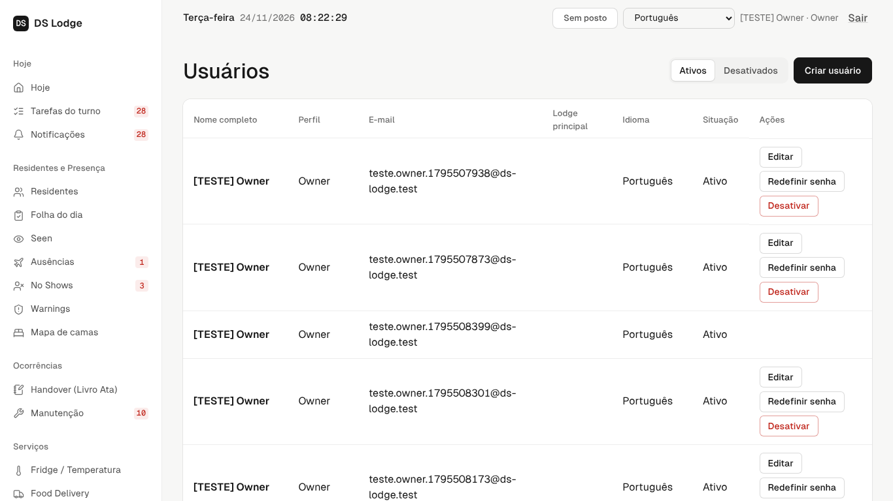

**Para que serve:** criar e administrar quem usa o sistema. **Só a gestão** faz isso.

### Criar um usuário
1. Abra **Usuários** e clique em **Criar usuário**.
2. Preencha **Nome completo**, **Nome curto** (opcional), **Perfil** (Porter, Cleaner, Manager ou Owner), **E-mail**, **Idioma** e **Lodge principal**.
3. Clique em **Salvar**.
4. A **Primeira senha** aparece **uma vez** na tela. **Entregue pessoalmente**: a pessoa troca no primeiro acesso.

**Cleaners não entram no sistema**: o Manager lança as horas deles (capítulo 23).

### Redefinir a senha
Clique em **Redefinir senha** na linha da pessoa. Uma nova senha provisória é gerada (entregue pessoalmente).

### Desativar e reativar
- **Desativar** encerra o acesso **na hora**; o histórico é mantido. Fica na aba **Desativados**.
- **Reativar** devolve o acesso.

🎥 Vídeo: **15**.

---

## 27. Auditoria (gestão)

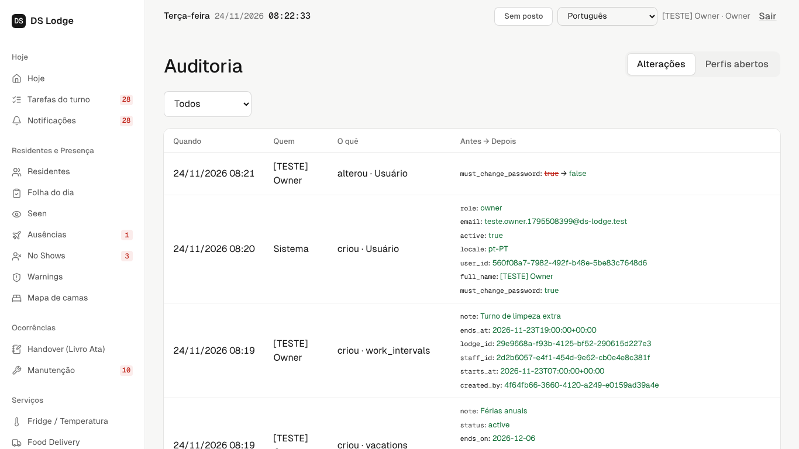

**Para que serve:** ver **tudo o que mudou** no sistema.

- Aba **Alterações:** cada linha mostra **quando, quem, o quê e o registro**, com o **antes e o depois**.
- Aba **Perfis abertos:** quem abriu o perfil de qual residente, e quando.

O histórico **não pode ser apagado nem editado**.

🎥 Vídeo: **15**.

---

## 28. No celular

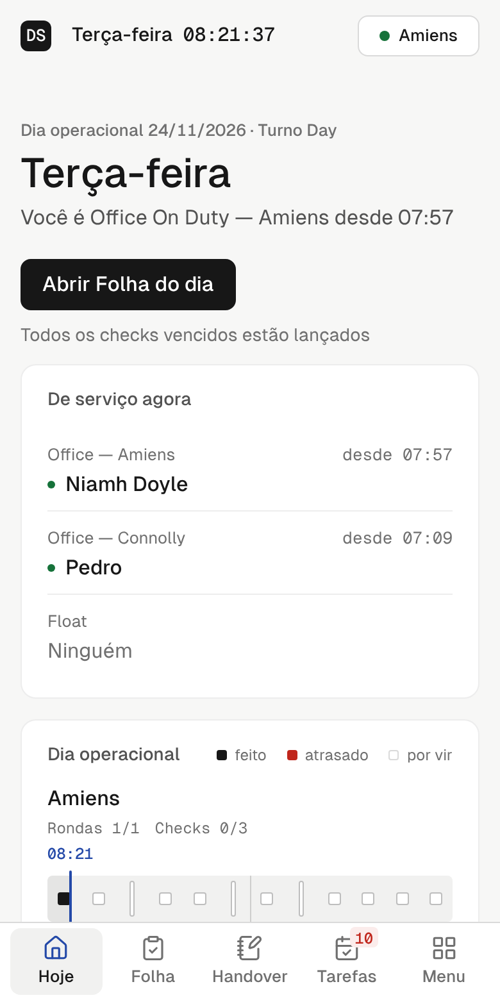

O sistema funciona no celular, com a mesma lógica:
- A **barra de baixo** dá acesso a **Hoje, Folha, Handover e Tarefas**.
- O botão **Menu** abre as demais telas e o seletor de **idioma**.
- As tabelas viram **cartões**, com botões grandes.

Use o computador da recepção para as tarefas longas (como o check completo).

🎥 Vídeo: **16**.

---

## 29. Rotina do turno, em resumo

**Ao começar o turno (Day 07:00 / Night 19:00)**
1. Entre no sistema e **assuma o posto**.
2. Abra **Hoje**: veja as pendências e a régua.
3. Leia as últimas anotações do **Handover** (o turno anterior).
4. Responda ao aviso de **tarefas** (ou **Depois**).

**Durante o turno**
- A cada **2 horas**: registre a **ronda** no Handover.
- **12:00 / 18:00 / 22:00**: lance o **check** na Folha do dia.
- Anote tudo o que acontece no **Handover**.
- Residente avisou que vai sair: **Ausência**. Voltou: **registre o retorno**.
- Algo quebrou: **Manutenção**. Problema com um residente: **Warning**.
- Geladeira: registre a **temperatura** (duas vezes por turno).
- Amiens: **Food Delivery** quando chegar entrega e **Dinner** entre 18h e 22h.
- Connolly: **Laundry** a cada uso.

**Ao terminar o turno**
1. Confira as **Pendências** de Hoje: não deixe checks, rondas ou tarefas para trás.
2. Lance no Handover o que ficou combinado para o próximo turno.
3. **Encerre o seu posto** e **saia**.

**Às 06h30 (fechamento do dia)**
- A gestão revisa a lista de **No Shows** do dia que terminou.

---

## 30. Problemas comuns e o que significam as mensagens

| Mensagem | O que significa / o que fazer |
|---|---|
| **Você saiu automaticamente após 15 minutos sem atividade.** | Segurança do sistema. Entre de novo. |
| **Assuma um posto para fazer registros.** | Você está sem posto. Vá em **Assumir Posto**. |
| **Você não tem permissão para esta ação.** | A ação é de outro perfil (por exemplo, só a gestão desativa FW) ou de outro Lodge. |
| **Você pode ver esta folha, mas não lançar** | Outro Lodge ou sem posto. |
| **Marque todos os residentes antes de lançar o check.** | Falta alguém na folha. Use a barra de progresso. |
| **Ainda não chegou o horário deste check.** | O check só abre 1 hora antes do horário. |
| **Lista incompleta: checks por lançar** | Há checks do dia sem lançar. Lance-os para liberar o No Show. |
| **O dia ainda não terminou — a lista final abre às 06h30.** | Espere o fechamento do dia. |
| **Esta pessoa já tem um turno neste horário.** | Conflito na Rota. Escolha outra pessoa ou outro horário. |
| **O cargo desta pessoa não permite esta função.** | Na Rota: Office só Porter; Float Porter ou Manager. |
| **Mais do que a quantidade comprada.** | Em Distribuição, a soma alocada passou do comprado. |
| **Esta máquina já está em uso.** | Finalize o uso atual antes de iniciar de novo. |
| **O Dinner deste dia já foi fechado.** | As sobras já foram fechadas; só o Owner edita. |
| **Este check já foi lançado e não pode mais ser alterado.** | A folha foi lançada. Correções são feitas pela gestão. |
| **Este residente não tem mais uma estadia aberta (já saiu ou foi transferido).** | A tela estava desatualizada. Recarregue. |
| **Temperatura impossível (de −40 a 40 °C).** | Digitou errado? Confira a leitura da geladeira. |
| **Outra pessoa alterou este registro. Recarregue antes de salvar.** | Duas pessoas editaram ao mesmo tempo. Recarregue a tela e refaça a alteração. |
| **Já passaram mais de 72 horas — agora só o Manager ou o Owner corrigem.** | Fim da janela de correção. Peça à gestão. |
| **Registro não encontrado.** | Link antigo ou o registro foi removido. Volte à lista. |
| **Este residente não está mais neste Lodge nesse horário.** | Escolha outro residente ou outro horário. |
| **Sem ligação com o servidor.** | O sistema só funciona online. Use a **folha impressa** e lance depois. |
| **Algo deu errado. Tente de novo.** | Erro inesperado: tente de novo e, se repetir, avise a gestão. |

**Se o sistema cair no meio do turno:** imprima/use a **folha do dia em papel** (Folha do dia → **Imprimir folha**), anote à mão e lance tudo quando voltar. O sistema pede **motivo** para lançamentos feitos depois do turno.

---

## 31. Glossário

- **Amiens St. / Connolly:** os dois Lodges.
- **Check-in:** a entrada do residente (conta como evidência de presença no dia).
- **Cleaner:** pessoa da limpeza (não entra no sistema; a gestão lança as horas).
- **Cobertura mínima:** 1 Office por turno e Lodge + 1 Float das 12h à meia-noite.
- **Evidência de presença:** check, visto manual, check-in ou Dinner “Sim”.
- **Float / Office:** funções do posto (ver capítulo 2).
- **FW:** Final Written Warning.
- **Handover:** o Livro Ata dos Lodges.
- **Out pendente:** saída decidida, ainda não efetivada.
- **PASS ID:** identificação do residente no sistema da assistência.
- **Posto:** a função que a pessoa assume no turno (Office ou Float).
- **Seen Day / Seen Night:** visto no turno Day / Night.

---

*Manual v1 — 24/11/2026. Acompanha o sistema: se uma tela mudar, o capítulo correspondente deve ser atualizado.*
